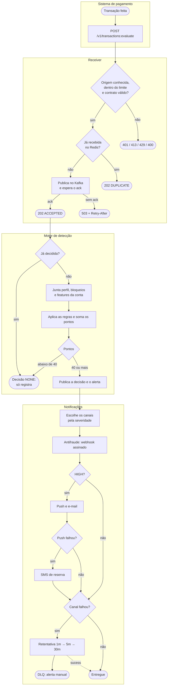
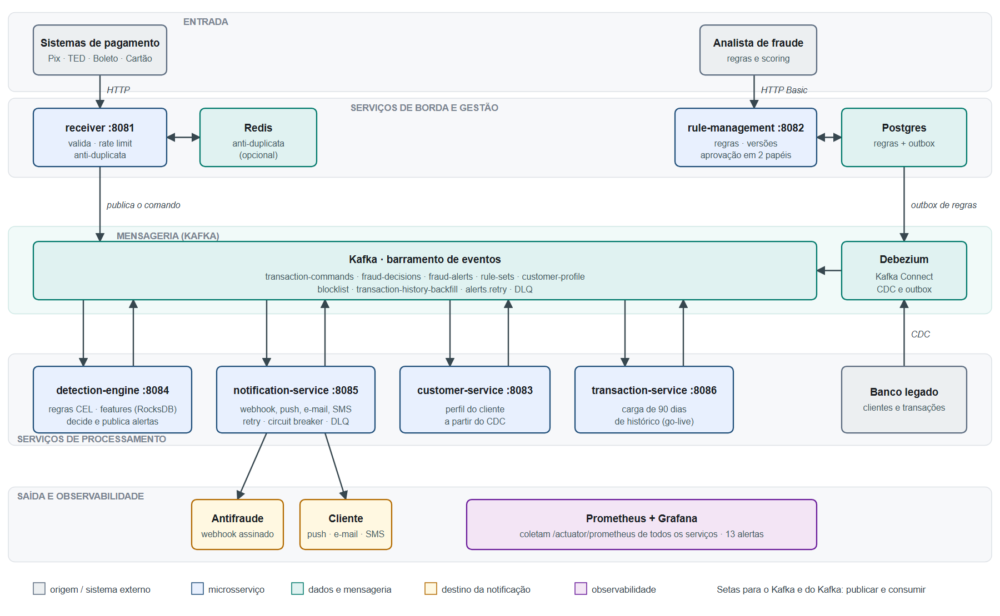
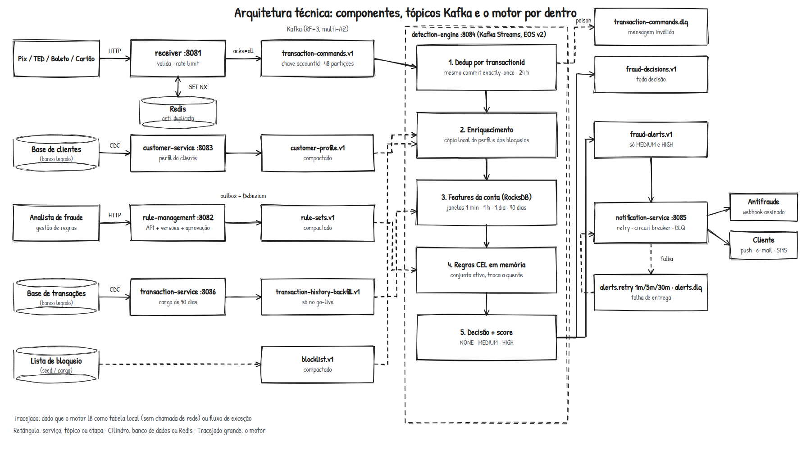
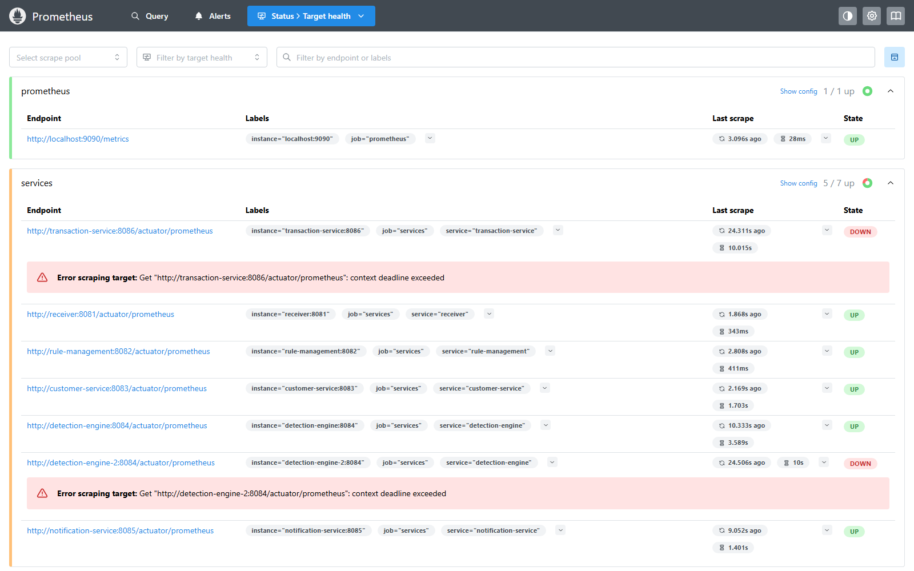
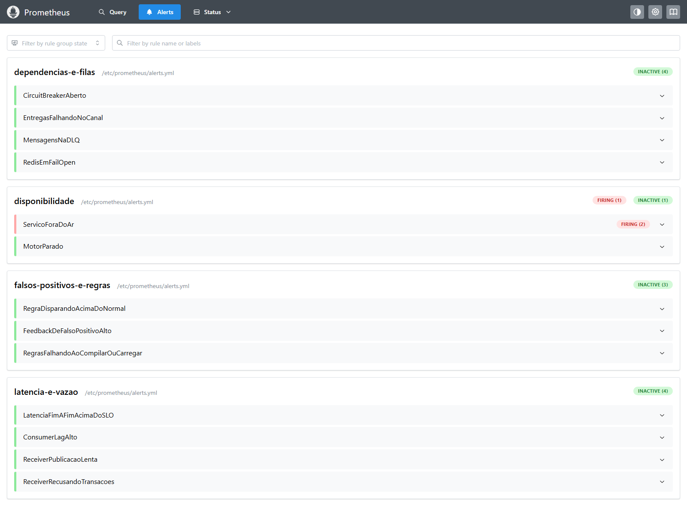
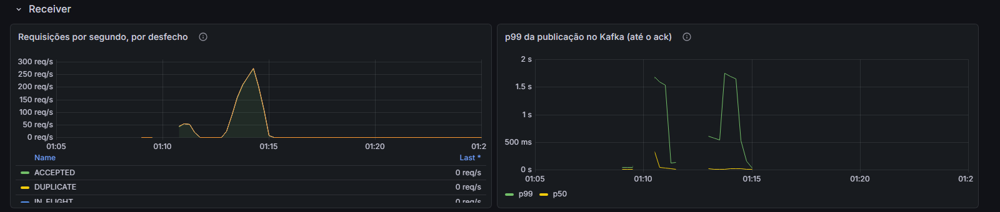
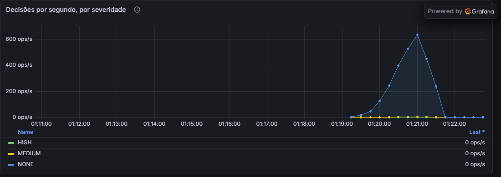

# Arquitetura e serviços do Motor de Detecção de Transações Suspeitas

Este documento é o ponto de partida: o que cada serviço faz, onde está o código e a documentação dele, como a transação
percorre o sistema (fluxo BPMN) e como as peças se encaixam (arquitetura).

Todos os endpoints, com request, response e finalidade: [`endpoints.md`](https://drive.google.com/file/d/1JoSVRTBV6Fo4eguQlMRGHAUUUb0EomGW/view).

---

## 1. Fluxo BPMN

Resumo do fluxo, por raia:



Os desenhos são fluxogramas com raias e decisões no estilo BPMN, sem a notação oficial completa.

Faixas padrão de severidade: `NONE` abaixo de 40, `MEDIUM` de 40 a 69 e `HIGH` de 70 em diante. Os valores mudam
por `PUT /v1/scoring`, sem deploy. `MEDIUM` vai só ao antifraude; `HIGH` vai ao antifraude, push e e-mail.

Fluxos paralelos, fora do caminho da transação (detalhes em [`fluxo-de-chamadas.md`](https://drive.google.com/file/d/1YuJBFQv9AtrRfVlsE55Ez4FNEXZpuVqq/view)):
1. **Regras:** analista cria e aprova na gestão de regras, outbox, Debezium, `rule-sets.v1`, o motor recompila e troca a quente.
2. **Perfil do cliente:** banco legado, CDC, customer-service, `customer-profile.v1`.
3. **Histórico:** banco legado, CDC (snapshot), transaction-service, `transaction-history-backfill.v1`.

---

## 2. Arquitetura

### 2.1 Desenho da arquitetura



O desenho mostra as camadas do sistema: quem envia dados, os serviços de borda e gestão, o Kafka como barramento central, os serviços de processamento e a saída. As setas ligadas ao Kafka indicam publicar e consumir.


### 2.2 Desenho técnico: componentes, tópicos e o motor por dentro

Leitura da esquerda para a direita:
- **Origens e serviços:** cada serviço lê de uma origem (à esquerda) e escreve em um tópico Kafka.
- **Tópicos de entrada do motor:** comandos (chave `accountId`, 48 partições), perfil, regras, histórico e bloqueios. Os quatro últimos são lidos como tabela local, por isso as setas tracejadas.
- **O motor (caixa tracejada):** cinco etapas dentro de um único Kafka Streams com exactly-once: deduplicação, enriquecimento, features da conta no RocksDB, regras CEL em memória e decisão com score.
- **Saídas:** toda decisão vai para `fraud-decisions.v1`; só `MEDIUM` e `HIGH` geram alerta em `fraud-alerts.v1`; mensagem inválida vai para a DLQ.
- **Notificações:** o `notification-service` entrega ao antifraude e ao cliente, e falhas de entrega seguem para as filas de retentativa e a DLQ de alertas.



### 2.3 Como o sistema funciona

O sistema recebe uma transação por HTTP, decide em tempo real se ela é suspeita e, se for, avisa o time antifraude e o cliente.
O caminho quente tem **dois serviços**: o `receiver` (porta de entrada) e o `detection-engine` (decisão). Todo o resto
alimenta o motor (regras, perfil, histórico) ou acontece depois dele (notificações).


Os tópicos `rule-sets.v1`, `customer-profile.v1` e `blocklist.v1` são **compactados**: o motor os lê como tabela e guarda
uma cópia local, então não faz nenhuma chamada de rede para decidir uma transação.

### 2.4 Princípios de projeto

| Princípio | Como aparece no código |
|---|---|
| **Responder rápido, decidir depois** | O receiver só valida, deduplica e grava no Kafka (responde `202`). A decisão é assíncrona. |
| **Nada de chamada de rede no caminho da decisão** | Regras, perfil, bloqueios e features ficam em memória ou RocksDB local do motor. |
| **Sem duplicar e sem perder** | Redis barra retries óbvios (otimização); o motor deduplica de forma definitiva por `transactionId` no mesmo commit exactly-once; `alertId` é UUIDv5; entregas usam `Idempotency-Key` por canal. |
| **Redis é opcional** | Se o Redis cair ou passar de 5 ms, o receiver segue em fail-open e o motor deduplica de qualquer forma. |
| **Regras sem deploy** | Gestão de regras publica o conjunto no tópico; o motor compila e troca a quente. Conjunto que não compila é ignorado e o anterior continua. |
| **Falha de um canal não trava os outros** | Retry com backoff, circuit breaker e bulkhead por canal; depois filas de retentativa e DLQ. |
| **Dados pessoais fora do estado** | Logs mascarados; o perfil e as features usam só tokens e hashes (LGPD). |
| **Observável por padrão** | Todo serviço expõe `/actuator/prometheus`; Prometheus (com 13 alertas) e Grafana vêm no compose. |

### 2.5 Infraestrutura local (docker compose)

| Componente | Para que serve |
|---|---|
| Kafka | Backbone de eventos. Tópicos criados por `infra/` |
| Redis | Escudo de duplicatas do receiver |
| Postgres | Regras (com outbox) e banco legado simulado |
| Debezium / Kafka Connect | Publica a outbox de regras e o CDC do banco legado |
| WireMock (`:18090`) | Simuladores do antifraude, push, e-mail e SMS |
| Prometheus (`:9090`) e Grafana | Métricas, alertas e painéis (`infra/`) |
| Perfis `app` e `chaos` | `app` sobe os serviços; `chaos` adiciona a 2ª instância do motor |

---

## 3. Serviços

Todos os repositórios estão em `https://github.com/luizavramos/<nome>` (privados).


### 3.1 Caminho da transação

| Serviço | Porta | O que faz | Código e documentação |
|---|---|---|---|
| **receiver** | 8081 | Porta de entrada. Autentica a origem (`X-Client-Id`), aplica rate limit, valida o JSON Schema, barra duplicata no Redis e publica `EvaluateTransaction` no Kafka. Só responde `202` depois do ack do Kafka; senão `503` com `Retry-After`. Sem estado próprio. | [repo](https://github.com/luizavramos/receiver) · [README](https://github.com/luizavramos/receiver#readme) |
| **detection-engine** | 8084 | Dono da decisão. Kafka Streams (exactly-once, sem Spring). Deduplica, junta perfil e lista de bloqueio, atualiza as features da conta (janelas de 1 min, 1 h e 1 dia), avalia as regras CEL, soma pontos e publica a decisão (`NONE`, `MEDIUM` ou `HIGH`) e os alertas. Mensagem inválida vai para `transaction-commands.dlq`. | [repo](https://github.com/luizavramos/detection-engine) · [README](https://github.com/luizavramos/detection-engine#readme) |
| **notification-service** | 8085 | Consome `fraud-alerts.v1`. Envia ao antifraude por webhook (todo alerta) e ao cliente por push e e-mail (só `HIGH`), com SMS de reserva se o push falhar. Retry, circuit breaker, bulkhead e filas de retentativa. Sem autenticação nos endpoints locais (limitação conhecida). | [repo](https://github.com/luizavramos/notification-service) · [README](https://github.com/luizavramos/notification-service#readme) |

### 3.2 Serviços que alimentam o motor

| Serviço | Porta | O que faz | Código e documentação |
|---|---|---|---|
| **rule-management** | 8082 | CRUD e versionamento de regras e da pontuação (limiares de severidade). Fluxo de aprovação com dois papéis: quem escreve não aprova a própria regra (`403`). Valida a regra compilando-a. Grava na outbox; o Debezium publica em `rule-sets.v1`. HTTP Basic, `ETag`/`304` e `Idempotency-Key`. | [repo](https://github.com/luizavramos/rule-management) · [README](https://github.com/luizavramos/rule-management#readme) |
| **customer-service** | 8083 | Transforma o CDC do cadastro do banco legado no perfil do cliente (segmento, idade da conta, últimos 10 dispositivos, troca de credencial) e publica em `customer-profile.v1`. Dados pessoais (nome, CPF, e-mail) nunca entram no estado nem no perfil. | [repo](https://github.com/luizavramos/customer-service) · [README](https://github.com/luizavramos/customer-service#readme) |
| **transaction-service** | 8086 | Carga inicial de 90 dias de histórico. Lê o snapshot do Debezium das transações e publica em `transaction-history-backfill.v1`, sem avaliar regras. Roda no go-live e sai do caminho. Estado do backfill em `/v1/backfill`. | [repo](https://github.com/luizavramos/transaction-service) · [README](https://github.com/luizavramos/transaction-service#readme) |

### 3.3 Bibliotecas e ferramentas (não são serviços)

| Repositório | O que é |
|---|---|
| [motor-fraude-parent](https://github.com/luizavramos/motor-fraude-parent) | Pom pai: versões, plugins e regras do Enforcer |
| [contracts](https://github.com/luizavramos/contracts) | JSON Schemas versionados, records Java e testes de contrato. Fonte única do que trafega nos tópicos |
| [platform-commons](https://github.com/luizavramos/platform-commons) | Logs JSON com mascaramento de dados pessoais, `traceparent`, Problem Details, regras ArchUnit |
| [platform-streams](https://github.com/luizavramos/platform-streams) | Base dos apps Kafka Streams: EOS, static membership, saúde e métricas sem Spring |
| [rules-kernel](https://github.com/luizavramos/rules-kernel) | Compila e avalia as regras em CEL. Usado pela gestão de regras (validação) e pelo motor (execução). Ver o spike em `SPIKE.md` |
| [auditor](https://github.com/luizavramos/auditor) | Confere que cada transação aceita tem exatamente uma decisão e que nenhum alerta saiu duplicado |
| [load-generator](https://github.com/luizavramos/load-generator) | Gerador de carga em modelo aberto, com cenários de fraude |

### 3.4 Quem fala com quem

| De | Para | Como |
|---|---|---|
| Sistema de pagamento | receiver | HTTP `POST /v1/transactions:evaluate` |
| receiver | Redis | `SET NX` do `transactionId` (timeout de 5 ms) |
| receiver | detection-engine | Kafka `transaction-commands.v1` |
| rule-management | detection-engine | Outbox, Debezium e Kafka `rule-sets.v1` (o motor **não** chama a API) |
| customer-service | detection-engine | Kafka `customer-profile.v1` |
| transaction-service | detection-engine | Kafka `transaction-history-backfill.v1` |
| detection-engine | notification-service | Kafka `fraud-alerts.v1` |
| notification-service | antifraude, push, e-mail, SMS | HTTP com `Idempotency-Key` `{alertId}:{CANAL}` |
| Analista | rule-management | HTTP Basic (REST) |

---


## 4. Observabilidade: Prometheus e Grafana


| Ferramenta | Endereço (ambiente local) | Acesso |
|---|---|---|
| Grafana | [http://localhost:3000](http://localhost:3000) | usuário `admin`, senha `admin` |
| Prometheus | [http://localhost:9090](http://localhost:9090) | sem login |
| Alertas do Prometheus | [http://localhost:9090/alerts](http://localhost:9090/alerts) | sem login |

Os endereços só funcionam com o ambiente rodando na sua máquina (`docker compose up -d prometheus grafana`).

Todo serviço expõe suas métricas em `/actuator/prometheus`. O **Prometheus** (`:9090`) coleta de todos a cada 15 s e avalia 13 regras de alerta; o **Grafana** (`:3000`) mostra o dashboard **Motor de fraude**, já provisionado, com uma seção por serviço.

```
serviços  ──/actuator/prometheus──►  Prometheus (coleta 15 s · 13 alertas)  ──►  Grafana (dashboard Motor de fraude)
```

### Prometheus
 A tela *Status → Targets* mostra cada serviço `UP` ou `DOWN`. A aba *Alerts* mostra o estado de cada regra (`inactive`, `pending`, `firing`).



### Alertas
 As regras ficam em `infra/prometheus/alerts.yml` e apontam o runbook da spec técnica.

| Grupo | Regras |
|---|---|
| Disponibilidade | `ServicoForaDoAr`, `MotorParado` (entrada chegando e nenhuma decisão saindo) |
| Latência e vazão | `LatenciaFimAFimAcimaDoSLO` (p99 acima de 500 ms), `ReceiverRecusandoTransacoes` (mais de 1% de 503), `ConsumerLagAlto`, `ReceiverPublicacaoLenta` |
| Falsos positivos e regras | `RegraDisparandoAcimaDoNormal`, `FeedbackDeFalsoPositivoAlto`, `RegrasFalhandoAoCompilarOuCarregar` |
| Dependências e filas | `CircuitBreakerAberto`, `EntregasFalhandoNoCanal`, `MensagensNaDLQ`, `RedisEmFailOpen` |



### Grafana
 O dashboard tem seis seções, na ordem do fluxo:
- **Receiver:** requisições por segundo por desfecho, p99 da publicação no Kafka, duplicatas barradas e fail-open do Redis.
- **Gestão de regras:** conjuntos publicados e falhas de compilação.
- **Perfil do cliente:** eventos do CDC e perfis publicados.
- **Motor de detecção:** latência fim a fim (p99 e p50 contra o SLO de 0,5 s), decisões por severidade, disparos por regra, lag do consumidor, versão do conjunto de regras e DLQ.
- **Notificações:** entregas por canal, latência do alerta até a entrega, circuit breakers, DLQ e feedback do analista.
- **Carga de histórico:** transações publicadas e velocidade da carga.

Dois painéis do dashboard, tirados depois do teste de carga: o tráfego do receiver (requisições por segundo e p99 da publicação no Kafka) e as decisões do motor por severidade.





