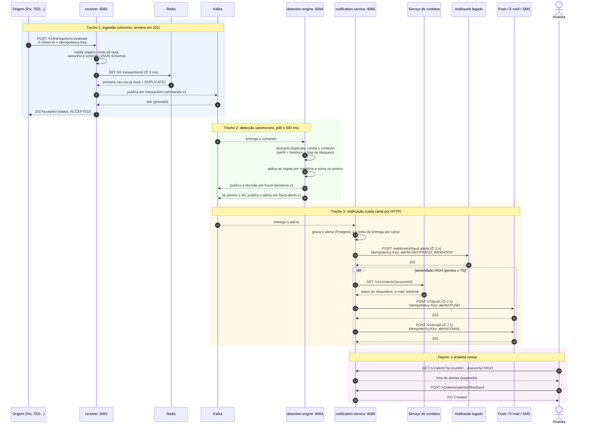
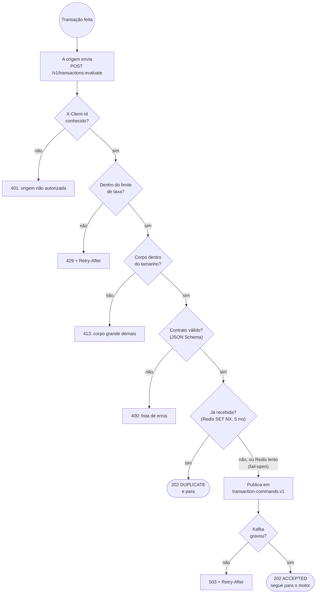
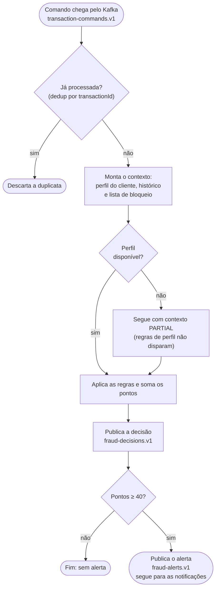
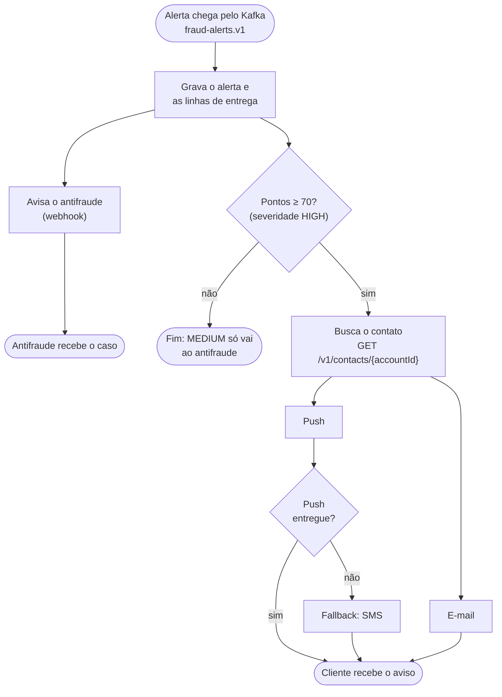
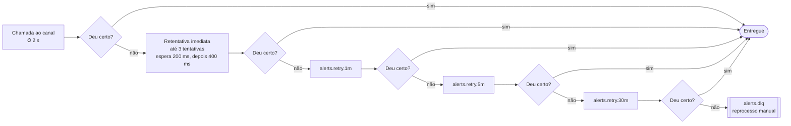
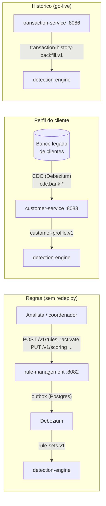

# Fluxo completo: da transação à notificação

Este documento mostra, passo a passo, tudo o que acontece desde o instante em que uma transação chega até o alerta
chegar ao antifraude e ao cliente: quais chamadas HTTP, quais tópicos Kafka, em que ordem, o que acontece quando algo falha
e quais limites de tempo valem.

Os endpoints, com request e response de cada um, estão em [endpoints.md](endpoints.md). Aqui o foco é a **sequência**.

Os diagramas foram escritos em [Mermaid](https://mermaid.js.org/): um texto que vira desenho. O GitHub e o VS Code (com a extensão
Markdown Preview Mermaid Support) já mostram o desenho pronto; em outros visualizadores, como o Drive, aparece só o texto. Para esses casos,
cada diagrama também está salvo como imagem em `docs/prints/`:
`fluxo-sequencia.png`, `fluxo-decisao-receiver.png`, `fluxo-decisao-motor.png`, `fluxo-decisao-notificacoes.png`,
`fluxo-falha-canal.png` e `fluxo-paralelos.png`.

## Em uma frase

A origem manda a transação por HTTP; o **receiver** a grava no Kafka e responde `202`; o **motor** lê do Kafka, aplica as
regras e publica a decisão (e o alerta, se houver); o **notification-service** lê o alerta e avisa o antifraude e o cliente
por HTTP. Só o primeiro e o último trecho são HTTP; o miolo é todo por Kafka, para que nada que possa cair fique no caminho
síncrono.

## Legenda

| Símbolo | Significado |
|---|---|
| Seta cheia `->>` | Chamada que espera resposta (HTTP) |
| Seta tracejada `-->>` | Resposta, ou mensagem assíncrona pelo Kafka (a mensagem fica gravada no tópico) |
| **`tópico.v1`** | Tópico do Kafka. Quem publica não espera quem consome |
| ⏱ | Limite de tempo da chamada |

---

## Diagrama 1: sequência de chamadas

### Os passos, um a um

| # | Quem | O quê | Se falhar |
|---|---|---|---|
| 1 | Origem → receiver | `POST /v1/transactions:evaluate`, com `X-Client-Id` e `Idempotency-Key` igual ao `transactionId` | A origem recebe o erro e decide se reenvia |
| 2 | receiver | Valida em ordem: origem (`401`), limite de taxa (`429`), tamanho (`413`), contrato (`400`) | Devolve o erro e **não** grava nada |
| 3 | receiver → Redis | `SET NX` no `transactionId`: só a primeira vez passa. Limite de 5 ms | **Fail-open**: Redis lento ou fora, o receiver segue sem o escudo (responde `ACCEPTED`) e o motor descarta a duplicata depois |
| 4 | receiver → Kafka | Publica em `transaction-commands.v1` e **espera o ack** | Kafka indisponível: `503` + `Retry-After`; a origem reenvia com o mesmo `Idempotency-Key` |
| 5 | receiver → origem | `202 Accepted`. Só sai depois do ack: a transação não se perde | — |
| 6 | motor | Lê o comando, descarta duplicata (por `transactionId`) | O que não foi processado fica retido no Kafka |
| 7 | motor | Monta o contexto: perfil do cliente, histórico (calculado no próprio fluxo) e lista de bloqueio | Sem perfil: segue com `contextCompleteness=PARTIAL` e as regras de perfil não disparam |
| 8 | motor | Aplica as regras (já em memória) e soma os pontos | Regra com erro nunca chega aqui: ela é validada ao ser cadastrada |
| 9 | motor → Kafka | Publica **sempre** a decisão em `fraud-decisions.v1`; se pontos ≥ 40, publica também o alerta em `fraud-alerts.v1` | Mensagem inválida vai para `transaction-commands.dlq` |
| 10 | notification-service | Lê o alerta, grava no Postgres e cria uma linha de entrega por canal | Postgres fora: pausa o consumo (o lag cresce, nada se perde) |
| 11 | notification-service → antifraude | `POST` do webhook. **Todo** alerta vai ao antifraude | Ver "Quando um canal falha" |
| 12 | notification-service → contatos | `GET /v1/contacts/{accountId}`: o serviço não guarda dado pessoal, busca na hora de enviar | Sem contato: entra na fila de retentativa |
| 13 | notification-service → push e e-mail | Só para severidade **HIGH** | Ver "Quando um canal falha" |

---

## Diagrama 2: fluxo de decisão (estilo BPMN)

Mostra as **decisões** do processo: onde a transação é recusada, onde ela para e quais canais cada severidade aciona. Um
diagrama por serviço, na ordem em que o processo passa por eles.

### 2.1 receiver: aceita ou recusa

### 2.2 detection-engine: decide se é suspeita

### 2.3 notification-service: quem é avisado

**Faixas de severidade** (configuráveis sem redeploy por `PUT /v1/scoring`; padrão do ambiente local):

| Pontos | Severidade | Quem é avisado |
|---|---|---|
| menos de 40 | `NONE` | Ninguém. Só a decisão é registrada |
| de 40 a 69 | `MEDIUM` | Antifraude |
| 70 ou mais | `HIGH` | Antifraude, cliente por push e por e-mail (com SMS se o push falhar) |

---

## Quando um canal falha

Cada canal tem a sua própria proteção, então um provedor lento não atrasa os outros.

- **Circuit breaker por canal:** com 50% de falhas o canal abre por 30 s e para de receber chamadas, para não piorar a situação do provedor.
- **Fallback:** se o **push** de um alerta HIGH falhar de vez, o aviso sai por **SMS**.
- **Sem duplicar aviso:** cada chamada leva `Idempotency-Key: {alertId}:{CANAL}`. Se a chamada for repetida, o provedor reconhece e não avisa o cliente duas vezes.
- **Visto na prática:** numa execução com o ambiente recém-criado, o push e o e-mail falharam na primeira tentativa e chegaram
  **1 minuto depois**, pela fila `alerts.retry.1m`; o webhook do antifraude foi chamado duas vezes com a mesma
  `Idempotency-Key` (reentrega do Kafka, tratada pela chave).

---

## Fluxos que acontecem em paralelo (não fazem parte da transação)

O motor não chama ninguém por HTTP durante a análise: tudo o que ele precisa já está em memória, alimentado por estes fluxos.

| Fluxo | Como chega ao motor | Quanto demora |
|---|---|---|
| **Regras novas ou mudança de threshold** | O rule-management grava o conjunto de regras numa tabela outbox; o Debezium publica em `rule-sets.v1`; o motor compila e troca sem parar | Meta de até ~35 s |
| **Perfil do cliente** | O Debezium lê as mudanças do banco legado (`cdc.bank.*`); o customer-service monta o perfil e publica em `customer-profile.v1` | Segundos; se parar, a defasagem aparece na métrica de frescor |
| **Histórico de 90 dias** | O transaction-service lê o banco de transações uma vez (go-live) e publica em `transaction-history-backfill.v1` | Uma vez, no início |

Se o **rule-management** cair, o motor segue com o último conjunto de regras (só não dá para publicar regra nova). Se o
**customer-service** cair, o motor segue com o último perfil (cópia local).

---

## Limites de tempo e metas

| O quê | Valor |
|---|---|
| Alerta gerado depois do recebimento (SLO) | p99 ≤ 500 ms |
| Resposta do receiver | só depois do ack do Kafka |
| Escudo de duplicata no Redis | 5 ms |
| Cada chamada a canal externo (antifraude, push, e-mail, SMS) | 2 s |
| Retentativa imediata | até 3 tentativas, 200 ms de espera, dobrando |
| Filas de retentativa | 1 min, 5 min, 30 min, depois `alerts.dlq` |
| Circuit breaker | abre com 50% de falha e fica aberto 30 s |
| Propagação de regra nova | meta de até ~35 s |

## O que está confirmado e o que não está

- **Confirmado no código e na execução:** ordem das validações do receiver, tópicos e nomes, política de canais por severidade
  (MEDIUM só antifraude; HIGH antifraude, push e e-mail; SMS de fallback do push), chamadas de contatos e dos provedores, valores de
  timeout, retentativas e circuit breaker, e o fato de o motor ler as regras pelo tópico `rule-sets.v1` e não por HTTP.
- **Do desenho, não medido aqui:** a meta de 500 ms ponta a ponta e os 8.000 TPS (ver `docs/resultados-carga.md`),
  e a assinatura HMAC do webhook do antifraude.
- **Desenho `fluxo-bpmn-sequencia.drawio` (raiz):** já reflete que o motor recebe as regras pelo tópico `rule-sets.v1`
  (antes mostrava uma consulta HTTP a cada 30 s, que o código não faz).
