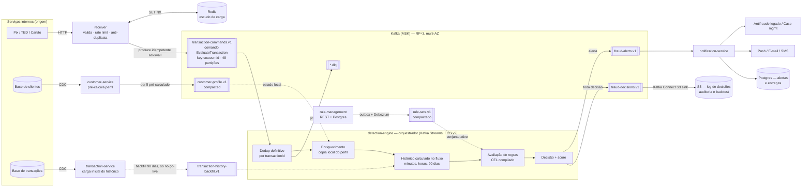
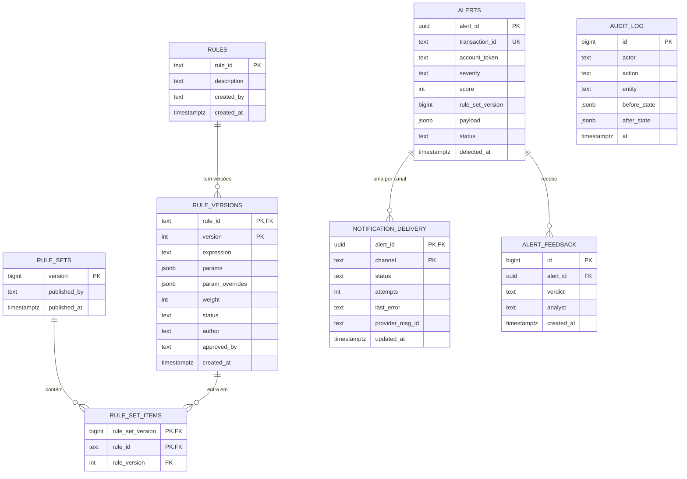

# Spec Técnica — Motor de Detecção de Transações Suspeitas em Tempo Real

> **Origem:** [business-spec-motor-deteccao-fraude.md](business-spec-motor-deteccao-fraude.md). Toda decisão aqui serve aos critérios de sucesso de lá (seção 9).
> **Convenções:** **[H]** = hipótese/premissa · **[ADR-n]** = decisão que deve virar um Architecture Decision Record no repositório · **[IMPL]** = implementado no take-home · **[DOC]** = apenas documentado/proposto.

---

## 0. Antes de começar: requisitos que precisam ser questionados

Uma boa spec não aceita o enunciado ao pé da letra. Quatro pontos do case precisam ser **reformulados** (e essa reformulação deve aparecer na apresentação, porque mostra maturidade):

| O case diz | Problema | Reformulação adotada |
|---|---|---|
| "Processado uma **única vez**" | *Exactly-once* ponta a ponta com efeitos colaterais externos (push, e-mail, REST de terceiros) é impossível em sistemas distribuídos: sempre existe a janela "chamei o provedor e caí antes de registrar". | **Effectively-once**: exactly-once *dentro* do Kafka (transações EOS) + at-least-once com **idempotência** nas bordas (chave de idempotência no provedor e unique constraint na entrega). O risco residual é declarado e medido. |
| "Alerta em no máximo **500 ms**" | "Máximo" absoluto não é mensurável nem garantível (GC, rebalance, rede). Entrega ao cliente depende de APNs/FCM/SMTP, fora do nosso controle. | **SLO: p99 ≤ 500 ms**, do *recebimento do evento no broker* até o *alerta comprometido no tópico interno*. Entrega ao cliente tem SLO próprio (p95 ≤ 5 s até o provedor aceitar). p99.9 é monitorado e discutido. |
| "Regras **sem redeploy**" | Qualquer padrão de fraude imaginável sem código exigiria uma linguagem Turing-completa em runtime (risco de segurança e de latência). | **Regras, thresholds, pesos e composições** mudam sem deploy (expressões CEL sobre um **catálogo de features**). Um **novo tipo de feature** (ex.: nova agregação temporal) exige deploy — trade-off explícito em favor de segurança e latência previsível. |
| "Funcionar se serviço auxiliar ficar indisponível" | "Funcionar" é ambíguo: funcionar igual? Degradado? | Tabela de **degradação por dependência** (seção 5.4): o que continua, o que degrada, o que é sinalizado na decisão. Nenhuma dependência auxiliar está no caminho síncrono crítico. |

---

## 1. Entendimento do problema técnico

Traduzindo a spec de negócio em termos de sistema:

| Necessidade de negócio | Requisito técnico |
|---|---|
| Avaliar toda transação rapidamente | Processamento de stream: 8k TPS sustentados, 25k TPS de pico, p99 ≤ 500 ms |
| Regras de velocidade ("N transações em X min") e de desvio de perfil | **Processamento com estado** por conta (janelas temporais, agregados), com baixa latência de leitura (sem round-trip de rede por evento) |
| Não perder evento e não duplicar alerta | Log durável e reprocessável; deduplicação por `transactionId`; chave de alerta determinística; idempotência na entrega |
| Time antifraude muda regras sozinho | Regras como dados, versionadas, validadas, propagadas em segundos, com shadow mode e rollback |
| Alertar time interno e cliente | Fan-out desacoplado por canal; falha de um canal não afeta os outros |
| Dependências instáveis | Nenhuma chamada síncrona a dependência auxiliar no caminho crítico; o que é externo é assíncrono com retry, circuit breaker, DLQ |
| LGPD e auditoria | Minimização (tokens no lugar de PII), criptografia, decisão explicável e rastreável (regra + versão + evidências) — atende inclusive o direito à revisão de decisão automatizada (LGPD art. 20) |
| SRE consegue operar | Métricas técnicas **e** de negócio, tracing ponta a ponta, SLOs com burn-rate alerts, runbooks |

**Ordem de grandeza** (da spec de negócio): ~690 M eventos/dia; ~0,1–1% geram alerta. Logo, **o caminho quente é a avaliação**, e a notificação é um fluxo de volume baixo, porém com integrações frágeis. Esses dois fluxos têm perfis opostos e por isso são **serviços separados**.

---

## 2. Arquitetura de alto nível (macro)

### 2.1 Visão geral



### 2.2 Componentes e responsabilidades

| Componente | Responsabilidade | Perfil | Escala |
|---|---|---|---|
| **receiver** | Porta de entrada HTTP: autentica a origem, valida o contrato, aplica rate limit, barra duplicatas óbvias (Redis) e publica o comando `EvaluateTransaction` no Kafka. **Sem estado próprio** | CPU leve + I/O | Horizontal (HPA por CPU/RPS), trivial |
| **Redis** | Escudo de carga do receiver: chaves `transactionId` com TTL curto. **Otimização, não garantia** | Memória | ElastiCache, 1 shard + réplica |
| **Kafka** (MSK em prod, KRaft local) | Backbone de eventos durável, ordenado por conta, reprocessável | I/O | Partições |
| **customer-service** | Dono dos dados de cliente para antifraude: consome o CDC da base de clientes, **pré-calcula** o perfil (segmento, idade da conta, dispositivos, troca de credencial) e publica em `customer-profile.v1` | Baixo volume | 2 réplicas |
| **transaction-service** | Dono dos dados de transação para antifraude: consome o CDC da base de transações. **Fora do caminho quente** (ADR-12): faz a carga inicial de 90 dias de histórico no go-live (e em reprocessamentos), publicando em `transaction-history-backfill.v1`; também cobre transações de canais que não passam pelo receiver **[DOC]** | Lote, sob demanda | 1–2 réplicas |
| **detection-engine** (orquestrador) | Dedup definitivo, enriquecimento com cópia local do perfil, histórico de transações calculado no fluxo, regras, decisão. **Único dono da decisão e único componente no caminho quente depois do receiver.** | CPU + estado local (RocksDB) | Horizontal até nº de partições |
| **rule-management** | CRUD/versionamento de regras, validação, aprovação (maker-checker), publicação | Baixo volume, alta criticidade de segurança | 2 réplicas |
| **notification-service** | Fan-out dos alertas para canais internos e externos com idempotência, retry e circuit breaker | I/O (virtual threads) | Horizontal |
| **Postgres** | Fonte da verdade de regras; registro de alertas e de entregas (para o analista e para idempotência) | Transacional, baixo volume | RDS Multi-AZ |
| **S3 + Kafka Connect** | Log imutável de **todas** as decisões (inclusive as não-alertas) para auditoria, backtest e treino futuro | Barato, append-only | Gerenciado |

### 2.3 Por que essa topologia — e as alternativas rejeitadas

**[ADR-1] Event-driven assíncrono com Kafka como backbone.**
O motor não está no caminho de autorização (premissa da spec de negócio), então não precisa responder de forma síncrona. Um log particionado dá, ao mesmo tempo: buffer para picos (25k TPS absorvidos mesmo se o motor ficar momentaneamente atrás), **ordem por conta** (pré-requisito para janelas temporais corretas), reprocessamento e desacoplamento temporal dos consumidores.

| Alternativa | Por que não |
|---|---|
| REST síncrono serviço → motor | Acopla disponibilidade da origem à do motor; sem buffer para pico; retries do cliente geram duplicatas |
| RabbitMQ / SQS | Bons para filas de trabalho, mas sem particionamento ordenado nativo por chave + reprocessamento + ecossistema de stream processing com estado; SQS FIFO tem limites de vazão por grupo |
| Kinesis | Viável na AWS, mas sem equivalente maduro a Kafka Streams/EOS; retenção e fan-out mais caros em alto volume |

Contrapartida: Kafka tem custo operacional e curva de aprendizado. Mitigada com serviço gerenciado (MSK). Como a origem fala HTTP, a entrada é o **receiver** (ADR-10), que só valida e enfileira: a origem nunca espera a detecção.

**Um único tópico de comando.** A entrada é um tópico só, `transaction-commands.v1`, cuja mensagem é o comando `EvaluateTransaction` ("avalie esta transação"). Não há um segundo tópico de "evento recebido": como o Kafka não apaga a mensagem ao consumir, a auditoria e o arquivamento leem o mesmo tópico com consumer groups próprios. Isso evita escrita em dois tópicos e duas cópias do mesmo dado. Alternativa considerada: tópico de comando + tópico de evento, com produtor transacional gravando nos dois — rejeitada porque o conteúdo seria idêntico.

**[ADR-2] Kafka Streams (estado local) em vez de consumidor stateless + Redis, ou Flink.**
Esta é a decisão mais importante da spec. As regras de velocidade e de perfil exigem estado por conta.

| Opção | Prós | Contras | Quando seria melhor |
|---|---|---|---|
| **Kafka Streams + RocksDB** ✅ | Estado local (leitura em µs, sem rede); **EOS v2** garante atomicidade offset + estado + saída; co-particionamento por conta; é uma biblioteca (deploy como app Java comum, sem cluster extra) | Rebalance pausa partições e o restore do estado pode ser lento; acoplado ao Kafka; escalar = rebalancear | Volume alto, estado particionável por chave, time Java — **nosso caso** |
| Consumidor stateless + Redis | Simples de entender; escala sem restore de estado; estado compartilhável | +1 round-trip de rede por evento (várias leituras/escritas de agregados por evento); Redis vira ponto de falha e de custo no caminho quente; idempotência e agregados ficam fora da transação do Kafka → janelas de inconsistência em crash | Estado pequeno ou que precisa ser consultado por outros serviços |
| Apache Flink | O mais poderoso: event time, watermarks, CEP nativo, savepoints, escala independente de partições | Cluster separado (JobManager/TaskManagers) → custo e complexidade operacional bem maiores; pesado para 7 dias | Múltiplos streams com joins complexos, CEP sofisticado, times de dados dedicados |

Escolha: **Kafka Streams**. Ganha-se latência e consistência transacional; paga-se em rebalance e restore — mitigados na seção 5.

**[ADR-3] Enriquecimento por estado local (CDC → customer-service → tópico compactado), não por chamada síncrona.**
O CDC (Debezium) da base de clientes alimenta o **customer-service**, que pré-calcula o perfil para antifraude (segmento, idade da conta, dispositivos conhecidos, horas desde a última troca de credencial) e publica em `customer-profile.v1` compactado, **co-particionado por `accountId`**. O motor materializa esse tópico como `KTable` — uma cópia local, consultada em microssegundos.
- ✅ A base de clientes **pode cair** sem afetar a detecção (requisito 4 do case).
- ✅ Zero latência de rede por evento.
- ❌ Dado eventualmente consistente (segundos a minutos de defasagem). Aceitável: perfil muda pouco. **Exceção:** eventos de risco que mudam rápido (troca de senha, novo dispositivo) devem chegar como eventos próprios, não esperar CDC.
- ❌ Duplica o dado de perfil no estado do motor (custo de disco). Mitigado pela minimização: só os atributos que regras usam, sem PII.

**[ADR-4] Detecção e notificação em serviços separados.**
Perfis opostos: o motor é CPU-bound, alto volume e precisa de latência previsível; o dispatcher é I/O-bound, baixo volume e lida com integrações lentas e instáveis. Juntos, um provedor de push lento poderia pressionar o motor (threads, memória). Separados, cada um escala e falha sozinho; o tópico `fraud-alerts.v1` é o contrato entre eles.

**[ADR-10] Receiver HTTP com Redis como escudo de carga.**
A origem chama por HTTP (`POST /v1/transactions:evaluate`). O receiver é stateless e faz, em ordem: autenticação (mTLS), validação de contrato (`400` para lixo, que nunca chega ao Kafka), rate limit por serviço de origem (`429`), checagem anti-duplicata e publicação no Kafka (`acks=all`); só então responde `202 Accepted`.
- **Anti-duplicata:** `SET transactionId NX EX 600` no Redis. Já existia → responde `202` (não erro, para não provocar novos retries) e não publica. Se a publicação no Kafka falhar → `DEL` da chave e `503`, para que o retry da origem não seja barrado.
- **O Redis é otimização, não garantia.** Ele tira duplicatas óbvias (retries da origem) da frente do núcleo. A garantia de processamento único continua no motor (dedup definitivo + EOS), porque existem duplicatas que o Redis não vê (reentrega dentro do Kafka, chave expirada, falha entre `SET` e publicação).
- **Redis indisponível → fail-open:** o receiver segue publicando, e o motor deduplica. Uma dependência auxiliar não para a entrada (requisito 4).
- ✅ Protege o núcleo de lixo, excesso e rajadas de retry; escala horizontalmente sem estado.
- ❌ Mais um salto (~10–20 ms) e mais um componente para operar. Aceito: a origem não espera a detecção, e a meta de 500 ms comporta.

**[ADR-11] Orquestração no motor — não SAGA, não scatter-gather.**
- **SAGA** serve para transação distribuída com **compensação** (desfazer passos já feitos). A detecção só lê e decide; não há o que compensar. Rejeitado.
- **Scatter-gather** (o motor chamaria customer-service e transaction-service a cada transação e juntaria as respostas) foi considerado: exige guardar estado de cada transação em andamento (25k/s), decidir o que fazer quando um serviço demora, e coloca três serviços no caminho crítico. Rejeitado.
- **Adotado:** o motor é o **orquestrador e único dono da decisão**. Os serviços de domínio **calculam fatos** e os **publicam**; o motor mantém cópia local e aplica as regras (vindas do rule-management). Assim as **regras compostas** (dados de cliente + transação) ficam num lugar só, e a queda de um serviço de domínio não para a detecção.

**[ADR-12] Histórico de transações calculado no próprio fluxo, não por chamada síncrona.**
O motor já recebe todas as transações, então mantém por conta os contadores de curto prazo (minutos/horas) e de longo prazo (dias, até 90).

| | Chamada síncrona ao transaction-service | **Calculado no fluxo** ✅ |
|---|---|---|
| Carga | 25k req/s no serviço e na base de transações | Nenhuma extra |
| Latência | +10–50 ms por transação | Microssegundos (estado local) |
| Se a dependência cair | Precisa de timeout, circuit breaker, decisão parcial | Não há dependência |
| Rajadas ("5 Pix em 30 s") | Depende de a base já ter gravado as anteriores | Exato: atualizado na hora |

Contrapartida: o histórico passa a ser responsabilidade do motor, e no go-live ele começa vazio. Quem resolve é o **transaction-service**: ele recebe o CDC da base de transações e, no go-live (ou num reprocessamento), publica 90 dias de histórico em `transaction-history-backfill.v1`. O motor consome esse tópico só para popular os buckets diários — esses registros **não** passam por regras nem geram alerta. Depois da carga, o transaction-service sai do caminho: nada na detecção depende dele. Ele também é o lugar natural para trazer transações de canais que **não passam pelo receiver** **[DOC]**.

---

## 3. Decisões de implementação (micro)

### 3.1 Linguagem e runtime — [ADR-5]

**Java 21 + Spring Boot 4.0** (rule-management, notification-service) e **Java 21 + Kafka Streams "puro"** com Micrometer no detection-engine.

| Opção | Prós | Contras |
|---|---|---|
| **Java 21** ✅ | Kafka Streams é nativo da JVM; ecossistema maduro (CEL-Java, Resilience4j, Testcontainers); records, sealed types, virtual threads; ZGC geracional com pausas sub-ms; [H] stack predominante em bancos grandes | Footprint de memória maior; startup lento (irrelevante para serviço long-running) |
| Kotlin | Mesmo runtime, mais conciso | Ganho marginal; avaliador pode querer ver Java idiomático |
| Go | Baixo footprint, ótima concorrência | Sem equivalente a Kafka Streams → cai na opção Redis (ADR-2) |
| Rust | Máxima performance | Custo de desenvolvimento alto para 7 dias; ecossistema de streaming imaturo |

Por que o motor **não** usa Spring: Kafka Streams já gerencia o ciclo de vida, e Spring adiciona startup, reflexão e abstrações que não servem ao caminho quente. Configuração por variáveis de ambiente + um bootstrap mínimo. Trade-off: menos "conveniência"; ganho: dependências enxutas, menor superfície de ataque, comportamento previsível.

### 3.2 Estrutura de código — Clean Architecture [ADR-9]

Cada serviço (detection-engine, rule-management, notification-service) segue as **quatro camadas da Clean Architecture**, com a **regra de dependência**: o código só pode depender de camadas mais internas. O domínio não sabe que Kafka, Spring ou Postgres existem.

```
        ┌───────────────────────────────────────────────┐
        │ 4. Infrastructure (frameworks & drivers)      │  Spring Boot, Kafka Streams config,
        │  ┌─────────────────────────────────────────┐  │  RocksDB, Postgres, clientes HTTP
        │  │ 3. Adapters (interface adapters)        │  │  Topologia Streams, controllers REST,
        │  │  ┌───────────────────────────────────┐  │  │  CelRuleEvaluator, repositórios, mappers
        │  │  │ 2. Application (use cases + ports)│  │  │  EvaluateTransaction, ActivateRule...
        │  │  │  ┌─────────────────────────────┐  │  │  │
        │  │  │  │ 1. Domain (entities)        │  │  │  │  Transaction, Rule, RuleSet, Decision,
        │  │  │  └─────────────────────────────┘  │  │  │  SlidingCounter, ScoringPolicy
        │  │  └───────────────────────────────────┘  │  │
        │  └─────────────────────────────────────────┘  │
        └───────────────────────────────────────────────┘
                 dependências apontam sempre para dentro →
```

| Camada | Contém | Pode depender de |
|---|---|---|
| **1. Domain** | Entidades e regras de negócio puras: `Transaction`, `Money`, `CustomerProfile`, `Rule`, `RuleSet` (imutável), `Decision`, `Alert`, `ScoringPolicy`, `SuppressionPolicy`, estruturas de features (`SlidingCounter`, `RecentSet`). Java puro (records, sealed interfaces). | Nada |
| **2. Application** | **Casos de uso** que orquestram o domínio + **portas** (interfaces) para o que vem de fora. | Domain |
| **3. Adapters** | Traduzem o mundo externo para os casos de uso e vice-versa: topologia Kafka Streams (adapter de entrada), controllers REST, `CelRuleEvaluator`, stores sobre RocksDB, repositórios Postgres, mappers DTO ↔ domínio. | Application, Domain |
| **4. Infrastructure** | Bootstrap, configuração de Spring/Kafka/DB, injeção de dependências, observabilidade. | Todas |

**Casos de uso e portas por serviço:**

| Serviço | Casos de uso (application) | Portas de saída (interfaces implementadas nos adapters) |
|---|---|---|
| receiver | `ReceiveTransactionUseCase` | `DuplicateGuard` (Redis), `RateLimiter`, `CommandPublisher` (Kafka) |
| customer-service | `ProjectCustomerProfileUseCase` | `ProfileProjectionPublisher` (Kafka) |
| transaction-service | `BackfillTransactionHistoryUseCase` | `TransactionHistorySource` (CDC/snapshot), `BackfillPublisher` (Kafka) |
| detection-engine | `EvaluateTransactionUseCase` | `DedupStore`, `ProfileRepository`, `FeatureStore`, `RuleSetProvider`, `RuleEvaluator`, `DecisionPublisher`, `Clock` |
| rule-management | `CreateRuleVersion`, `ValidateRule`, `ShadowRule`, `ActivateRule`, `DisableRule`, `RollbackRuleSet`, `DryRunRule` | `RuleRepository`, `RuleEvaluator`, `AuditLog` (o conjunto publicado sai por evento via outbox; o ativo também é servido por `GET /v1/rule-sets/active`) |
| notification-service | `DispatchAlertUseCase`, `RetryDeliveryUseCase`, `RegisterFeedbackUseCase` | `AlertRepository`, `DeliveryRepository`, `NotificationChannel` (push, e-mail, SMS, webhook), `ContactDirectory` |

**Estrutura de pastas:**

```
fraud-detection/
├── contracts/                    # schemas de eventos/APIs. Sem lógica.
├── rules-kernel/                 # shared kernel: Rule, RuleSet, catálogo de features, porta RuleEvaluator
│                                 #   + adapter CEL (usado pelo motor E pelo rule-management na validação)
├── receiver/                     # mesmas 4 camadas; adapters: in/rest, out/redis, out/kafka
├── customer-service/             # mesmas 4 camadas; adapters: in/cdc (Kafka Connect/Debezium), out/kafka
├── transaction-service/          # mesmas 4 camadas; adapters: in/cdc, out/kafka (backfill)
├── detection-engine/
│   ├── domain/                   # Transaction, Decision, SlidingCounter, RecentSet, ScoringPolicy
│   ├── application/
│   │   ├── usecase/              # EvaluateTransactionUseCase
│   │   └── gateway/             # DedupStore, FeatureStore, ProfileRepository, DecisionPublisher...
│   ├── adapters/
│   │   ├── in/streams/           # Processor do Kafka Streams → chama o use case
│   │   └── out/                  # RocksDbDedupStore, RocksDbFeatureStore, KTableProfileRepository...
│   └── infrastructure/           # bootstrap, StreamsConfig, métricas, OTel
├── rule-management/              # mesmas 4 camadas; adapters: in/rest, out/postgres
├── notification-service/             # mesmas 4 camadas; adapters: in/kafka, in/rest, out/postgres, out/channels
├── load-generator/
└── deploy/                       # docker-compose, dashboards Grafana, (Helm [DOC])
```

**Como o caminho quente fica na Clean Architecture:** o `Processor` do Kafka Streams (adapter de entrada) recebe o registro, converte o DTO para `Transaction` e chama `EvaluateTransactionUseCase.execute(tx)`. O caso de uso usa as portas `DedupStore`, `FeatureStore` e `ProfileRepository`, implementadas por adapters que **envolvem os state stores locais do Kafka Streams**. A transação EOS (offset + estado + saída) é responsabilidade da infraestrutura; o caso de uso nem sabe que ela existe, mas se beneficia dela, porque todas as escritas nas portas acontecem dentro dela.

**Por que Clean Architecture aqui:**
- ✅ **Testabilidade:** casos de uso testados com implementações em memória das portas — milhares de cenários em milissegundos, sem Kafka.
- ✅ **Backtest com o mesmo código:** o `EvaluateTransactionUseCase` pode rodar sobre o log de decisões no S3 trocando só os adapters.
- ✅ **Troca de tecnologia sem tocar no negócio:** Kafka Streams → Flink, ou CEL → outro motor, muda só a camada de adapters (argumento forte na discussão de trade-offs).
- ✅ **Regras de negócio legíveis:** o avaliador encontra a lógica de fraude em um lugar, sem misturar com serialização ou retry.

**Contras (e como lidar):**
- ❌ **Mais classes e mapeamentos** (DTO ↔ domínio em cada borda). Mitigação: mappers simples à mão nos fluxos quentes (sem reflection) e records para reduzir boilerplate.
- ❌ **Indireção no caminho quente** (chamadas via interface). Custo desprezível na JVM (o JIT faz inlining de chamadas monomórficas); medido no teste de carga.
- ❌ **Risco de excesso de cerimônia** em serviços simples. Regra adotada: sem "use case" vazio que só repassa para o repositório; consultas simples de leitura (ex.: `GET /alerts`) podem ir do controller direto para uma porta de leitura (CQRS leve).

**Garantia automática da regra de dependência:** testes **ArchUnit** no CI falham se `domain` importar algo de `application`/`adapters`/`infrastructure`, ou se `application` importar Spring, Kafka ou JDBC.

Padrões usados dentro das camadas (e por quê): **Strategy** (`NotificationChannel`: push, e-mail, SMS, webhook interno — Open/Closed para novos canais); **Specification/Composite** (regras compostas); **Estado local alimentado por evento** (o motor mantém o `RuleSet` em memória e o atualiza pelo tópico `rule-sets.v1`); **Copy-on-write / imutabilidade** (`RuleSet` trocado atomicamente via `AtomicReference`, sem locks no caminho quente).

### 3.3 Topologia do detection-engine

Por evento, **na mesma transação EOS**:

1. **Consume** `transaction-commands.v1` (key = `accountId`).
2. **Validação de contrato** — falha → `transaction-commands.dlq` com motivo (não bloqueia a partição).
3. **Dedup** — state store `seen-tx` (`transactionId → timestamp`, retenção 24h **[H]**, configurável). Já visto → descarta e incrementa métrica `duplicates_dropped`. É o dedup **definitivo**: o Redis do receiver só filtra antes, sem garantia (ADR-10). Funciona localmente porque a mesma transação tem a mesma conta → mesma partição.
4. **Enriquecimento** — lookup em `KTable<accountId, CustomerProfile>` + `GlobalKTable` de blocklist de contas/dispositivos sinalizados. Perfil ausente → `contextCompleteness = PARTIAL`.
5. **Features** — lê e atualiza o agregado da conta (`account-features` store). *Nota:* a feature é calculada **incluindo** a transação atual.
6. **Avaliação** — `RuleSet` corrente em memória (atualizado pelo tópico `rule-sets.v1`, ADR-13), regras ACTIVE e SHADOW.
7. **Decisão** — score + severidade; emite em `fraud-decisions.v1` (sempre) e `fraud-alerts.v1` (se severidade ≥ MEDIUM e regra ACTIVE).

`processing.guarantee=exactly_once_v2` garante: se o pod cair entre os passos 3 e 7, **nada** é comprometido (nem offset, nem estado, nem saída), e o reprocessamento produz o mesmo resultado. É isso que torna o dedup do passo 3 e os agregados do passo 5 corretos sob falha.

### 3.4 Estruturas de dados das features (o "algoritmos" do case)

O estado por conta precisa ser **pequeno, O(1) para atualizar e limitado em memória**, porque existe para milhões de contas.

**a) Contador/somador de janela deslizante — buckets hierárquicos em anel**
- 60 buckets de 1 min (cobre 1h) + 24 buckets de 1h (cobre 24h) + 90 buckets de 1 dia (cobre 90 dias, ADR-12); cada bucket guarda `count`, `sum` e `max` (valores em centavos, `long`).
- Atualização O(1): calcula o índice do bucket por `epochMinute % 60`; se o bucket é de outro período, zera antes (rotação preguiçosa).
- Consulta O(B): soma os buckets dentro da janela (B ≤ 174).
- Tamanho: 174 × 24 bytes ≈ **4 KB por conta**, independente do volume de transações.
- Precisão: janela de "5 min" tem erro de até 1 bucket na borda. **Trade-off aceito** — alternativa exata (guardar todos os timestamps) tem memória ilimitada para contas PJ de alto volume.
- Alternativa considerada: windowed stores nativos do Kafka Streams (`TimeWindows`). Rejeitado como base porque cria um registro por janela/chave e várias janelas sobrepostas multiplicam I/O; o anel serializado em um único valor é uma leitura + uma escrita por evento.

**b) Beneficiários recentes — conjunto LRU limitado**
- Últimos N=50 beneficiários (token) com timestamp do último uso → feature `isNewBeneficiary`, `distinctBeneficiaries24h`.
- Limitado a N para não crescer sem fim. Contas que excedem → feature `beneficiaryCardinalityHigh` (o próprio limite vira sinal).
- Alternativa: HyperLogLog para contagem distinta (memória constante) — não responde "este beneficiário é novo?", que é a pergunta mais valiosa. Fica como evolução para cardinalidade em contas PJ.

**c) Dispositivos conhecidos** — mesmo padrão de conjunto limitado (N=10).

**d) Dedup** — store chave-valor com TTL. **Não** usar Bloom filter: falso positivo descartaria uma transação real sem avaliação — erro inaceitável em antifraude.

Catálogo inicial de features (o "vocabulário" das regras):

| Feature | Fonte |
|---|---|
| `tx.amount`, `tx.type`, `tx.channel`, `tx.hourOfDay`, `tx.counterpartyBank` | Evento |
| `profile.accountAgeDays`, `profile.segment`, `profile.hoursSinceCredentialChange` | Perfil pré-calculado pelo customer-service (CDC) |
| `features.count1m/5m/1h/24h`, `features.sum1h/24h` | Anel de buckets (curto prazo) |
| `features.avgAmount30d`, `features.maxAmount90d`, `features.count30d` | Anel de buckets diários (longo prazo, calculado no fluxo) |
| `features.isNewBeneficiary`, `features.distinctBeneficiaries24h`, `features.isNewDevice` | Conjuntos limitados |
| `lists.counterpartyFlagged`, `lists.deviceFlagged` | Blocklists (GlobalKTable) |

### 3.5 Motor de regras configurável — [ADR-6]

**Linguagem de expressão: CEL (Common Expression Language, `cel-java`).**

| Opção | Prós | Contras |
|---|---|---|
| **CEL** ✅ | Não Turing-completo (sem loops infinitos → tempo de avaliação limitado); **sem efeitos colaterais** (seguro por design); compila e verifica tipos contra um schema; avaliação em µs; usado em produção em Kubernetes, Envoy, Google IAM | Menos conhecido; regras muito complexas ficam verbosas |
| Drools | Poderoso (Rete, encadeamento, tabelas de decisão) | Pesado, curva de aprendizado alta, overhead de memória; Rete compensa com milhares de regras interdependentes — não é o caso |
| JSONLogic | Simples, serializável, fácil de gerar por UI | Sem checagem de tipos; verboso; erros só em runtime |
| SpEL / Groovy / JS embarcado | Flexível | **Risco de injeção de código / RCE** — inaceitável em sistema financeiro; sandbox frágil |

**Modelo de regra:**

```json
{
  "ruleId": "R-VELOCITY-NEW-BENEF",
  "version": 3,
  "status": "ACTIVE",
  "description": "Muitas transferências em 5 min com beneficiário novo",
  "expression": "features.count5m > params.maxCount && features.isNewBeneficiary && tx.amount > params.minAmount",
  "params": { "maxCount": 4, "minAmount": 50000 },
  "paramOverrides": { "segment == 'PJ'": { "maxCount": 20 } },
  "weight": 40,
  "reasonTemplate": "{{features.count5m}} transações em 5 min para beneficiário novo",
  "author": "analista.x", "approvedBy": "coord.y",
  "createdAt": "2026-11-12T10:00:00Z"
}
```

- **Thresholds dinâmicos:** separados da expressão em `params`, com overrides por segmento → muda-se o número sem tocar na lógica (menos risco de erro).
- **Regras compostas:** (1) dentro da expressão (`&&`, `||`); (2) por **score**: cada regra disparada soma `weight`; a `ScoringPolicy` (também configurável) mapeia score → severidade (ex.: ≥ 70 HIGH → cliente + antifraude; 40–69 MEDIUM → só antifraude; < 40 sem alerta). Isso permite que vários sinais fracos juntos gerem alerta — o padrão de mercado (Feedzai, Stripe Radar).
- **Estados da regra:** `DRAFT → SHADOW → ACTIVE → DISABLED`. Em **SHADOW** a regra é avaliada e registrada em `fraud-decisions` (`shadowHits`), mas **não** soma score nem gera alerta → o time mede quantos alertas e quais casos ela geraria antes de ativar.
- **Kill switch:** `DISABLED` em uma regra, ou rollback do `RuleSet` inteiro para a versão N-1, em segundos.

**Ciclo de publicação (sem redeploy):**

```mermaid
sequenceDiagram
    participant A as Analista
    participant RM as rule-management
    participant PG as Postgres
    participant E as detection-engine (cada instância)
    A->>RM: POST /rules/{id}/versions (expressão + params)
    RM->>RM: compila CEL contra o schema do catálogo de features (tipos)
    RM->>RM: executa casos de teste da regra
    A->>RM: POST .../shadow → depois .../activate (aprovador ≠ autor)
    RM->>PG: TX única: grava versão + novo rule_set (N+1) + linha na outbox (conjunto completo, rule-set.v1)
    PG-->>DBZ: Debezium lê a outbox pelo WAL
    DBZ->>K: publica em rule-sets.v1 (compactado, chave fixa)
    K-->>E: cada instância do motor consome o último conjunto
    E->>E: compila; se OK troca AtomicReference<RuleSet>; se falha mantém versão anterior + métrica + alerta
    Note over E: cada Decision registra ruleSetVersion
```

**[ADR-13] Gestão de regras publica o conjunto por evento (outbox + Debezium) em tópico compactado.**
- **Nenhuma transação chama a gestão de regras.** O motor guarda o conjunto ativo em memória e o atualiza quando chega um evento. Chamar a gestão a cada transação seria ~690 M chamadas/dia por algo que muda poucas vezes ao dia, e transformaria a gestão em dependência crítica (contra o requisito 4 do PDF).
- **Como:** na **mesma transação** que grava o novo `rule_set`, a gestão insere uma linha na tabela `outbox` com o conjunto completo (schema `rule-set.v1`). O Debezium (Outbox Event Router) lê o WAL e publica em `rule-sets.v1`: uma partição, **compactado**, chave fixa `active`. Não há escrita dupla (banco e Kafka): o que não foi gravado no banco nunca vira evento.
- **Por que evento e não polling:** a propagação cai de até 30 s para alguns segundos, o que importa para o **kill switch** no incidente de "aumento súbito de falsos positivos"; a gestão deixa de ser consultada pelas instâncias do motor; e uma instância nova lê o último conjunto do próprio tópico, sem chamada HTTP e sem snapshot em disco.
- **Entrega:** pelo menos uma vez e em ordem (uma partição). O motor ignora um evento de versão menor ou igual à que já tem, então um reenvio não faz mal.
- **Gestão fora do ar:** o motor não depende dela; o tópico guarda o último conjunto. **Kafka ou Debezium fora do ar:** as publicações ficam na outbox e saem quando voltarem; o motor segue com o último conjunto. **Nenhum evento ainda** (ambiente novo): o pod **não fica pronto** (readiness falha) e não recebe partições, então o motor nunca avalia transações sem regras.
- **`GET /v1/rule-sets/active` continua** (com `ETag`), para operação, depuração e reconciliação. Deixa de ser o caminho do motor.
- ❌ Contrapartidas: mais peças (tabela outbox, Debezium, tópico e `wal_level=logical` no Postgres da gestão); o consumidor precisa tratar versão e ordem; o evento replica o conjunto inteiro (dezenas de regras, alguns KB). Alternativa descartada: polling com `ETag` a cada 30 s (mais simples, mas com propagação de até um intervalo).

- **Propagação:** alguns segundos (latência do Debezium e do consumo).
- **Validação dupla:** no rule-management (feedback ao autor) e no motor (defesa em profundidade: o motor nunca aplica algo que não compila).
- **Consistência entre instâncias:** durante alguns segundos, instâncias diferentes podem estar em versões diferentes. **Aceito** — cada decisão carrega `ruleSetVersion`, então a auditoria é exata.
- **Proteção de latência:** limite de custo de expressão no compile (CEL permite estimar custo) + timeout/métrica por regra; regra lenta é sinalizada no dashboard.

O limite honesto: **nova feature** (ex.: "soma de valores por beneficiário em 7 dias") exige código + deploy, porque cria novo estado. Mitigação: catálogo de features generoso desde o início e features parametrizáveis (janela como parâmetro dentro do conjunto de buckets disponível).

### 3.6 Idempotência e deduplicação — [ADR-7]

São **três problemas diferentes**, cada um com sua solução:

| Camada | Risco | Solução |
|---|---|---|
| **1. Produtor → Kafka** | Retry de rede do produtor grava a mensagem 2× | `enable.idempotence=true`, `acks=all` (sequência por produtor no broker) |
| **2. Evento de negócio duplicado** | A origem republica a mesma transação (retry da aplicação, replay) com novo offset | Dedup por `transactionId` no state store `seen-tx`, dentro da transação EOS |
| **3. Processamento do motor** | Crash após processar e antes de commitar → reprocessa | **EOS v2**: offset, estado e saídas comprometidos atomicamente; consumidores leem com `isolation.level=read_committed` |
| **4. Alerta ao cliente** (efeito externo) | Dispatcher chama o provedor e cai antes de registrar | `alertId = UUIDv5(namespace, transactionId)` (determinístico) → `INSERT ... ON CONFLICT (alert_id, channel) DO NOTHING` em `notification_delivery`; envio com `Idempotency-Key = alertId:channel` quando o provedor suporta |
| **5. Alertas distintos "iguais"** para o cliente | 10 transações suspeitas em 1 min → 10 pushes (fadiga) | **Supressão/agrupamento**: chave `accountId + severidade + janela de 10 min`; o primeiro gera push, os demais são agregados ("+9 transações suspeitas") no alerta interno. Configurável. |

**Risco residual declarado:** na camada 4, se o provedor não suporta idempotency key e o processo cai exatamente entre "provedor aceitou" e "marcar SENT", o cliente pode receber 2 pushes. Probabilidade baixíssima; impacto baixo; mensurável (reconciliação diária com relatórios do provedor). A alternativa (2PC com o provedor) não existe na prática.

### 3.7 notification-service

- Consome `fraud-alerts.v1` (read_committed). Para cada alerta: persiste em `alerts` (Postgres, para a API do analista e auditoria) e cria uma linha de entrega por canal.
- **Canais internos:** publica/encaminha ao sistema antifraude legado via adapter (REST webhook ou tópico, conforme o contrato do sistema) e à ferramenta de case management.
- **Canais externos:** push (FCM/APNs via serviço interno de notificação **[H]**), e-mail, SMS como fallback. **O dispatcher não tem PII:** busca token de dispositivo/e-mail no serviço de contatos no momento do envio (minimização LGPD), com cache curto.
- **Resiliência por canal (Resilience4j):** timeout (2 s), circuit breaker, retry com backoff exponencial + jitter; esgotado o retry imediato → **retry topics não bloqueantes** (`alerts.retry.1m`, `.5m`, `.30m`) → `alerts.dlq`. Cada canal tem seu próprio bulkhead: SMTP lento não atrasa push.
- **Fallback de canal:** push falhou definitivamente → SMS (com política de custo).
- **I/O:** virtual threads (Java 21) — milhares de chamadas concorrentes bloqueantes sem pool reativo complexo.
- **Integração com outros sistemas antifraude:** além do tópico, **webhooks assinados (HMAC)** para consumidores que só falam HTTP — integração "flexível" pedida pelo case sem acoplar o motor a cada sistema.

---

## 4. Dados e contratos

### 4.1 Tópicos

| Tópico | Chave | Partições | Retenção | Política |
|---|---|---|---|---|
| `transaction-commands.v1` | `accountId` | 48 | 7 dias | delete |
| `customer-profile.v1` | `accountId` | 48 (co-particionado) | — | compact |
| `transaction-history-backfill.v1` | `accountId` | 48 (co-particionado) | 7 dias (usado só no go-live/reprocessamento) | delete |
| `blocklist.v1` | `entityToken` | 6 | — | compact |
| `rule-sets.v1` | `active` (chave fixa) | 1 | — | compact |
| `fraud-decisions.v1` | `accountId` | 48 | 3 dias (fonte de verdade de longo prazo é o S3) | delete |
| `fraud-alerts.v1` | `accountId` | 12 | 7 dias | delete |
| `alerts.retry.*`, `*.dlq` | — | 6 | 14 dias | delete |

**Por que 48 partições:** paralelismo máximo = nº de partições. 25k TPS / 48 ≈ 520 evt/s por partição — folgado para uma thread Streams (benchmark local valida). Permite até 48 threads sem repartição (repartição de tópico com estado é cara). Mais partições = mais overhead de broker, mais tempo de rebalance e de restore — 48 é o equilíbrio para ~3× de crescimento. **[H]** validar com teste de carga.

**Hot keys:** contas PJ de altíssimo volume concentram uma partição. Mitigação: monitorar lag por partição; para outliers, regras PJ podem usar chave composta (`accountId#shard`) em um tópico separado **[DOC]**.

**Formato:** Avro + Schema Registry em produção (contrato tipado, evolução `BACKWARD` validada no CI, payload ~40% menor que JSON). **Simplificação [IMPL]:** JSON validado por JSON Schema no take-home para reduzir peças no compose — declarada na apresentação.

### 4.2 Contrato de entrada — comando `EvaluateTransaction`

**HTTP (origem → receiver):** `POST /v1/transactions:evaluate`, header `Idempotency-Key: <transactionId>`, corpo abaixo.
Respostas: `202 Accepted` (aceito ou duplicata já aceita) · `400` (contrato inválido) · `401/403` · `429` (rate limit, com `Retry-After`) · `503` (Kafka indisponível; a origem deve tentar de novo).

**Kafka (receiver → motor):** o mesmo corpo, publicado em `transaction-commands.v1` com header `commandType=EvaluateTransaction`, `traceparent` e `receivedAt` (instante de chegada no receiver, início da medição do SLO).

```json
{
  "schemaVersion": 1,
  "eventId": "01JD0Y...",              // ULID; id da mensagem
  "transactionId": "E60701190202611121035abc", // id de negócio (idempotência)
  "accountId": "acc_tok_8f3a...",      // TOKEN, nunca número real da conta
  "customerId": "cus_tok_21b9...",     // TOKEN, nunca CPF
  "type": "PIX_OUT",                    // PIX_OUT | TED_OUT | CARD_PURCHASE | ...
  "amount": { "value": 150000, "currency": "BRL" },  // centavos em long (nunca double)
  "counterparty": { "accountToken": "acc_tok_77c...", "bankIspb": "00000000" },
  "channel": "MOBILE_APP",
  "deviceIdHash": "sha256:...",
  "occurredAt": "2026-11-12T10:35:01.123Z",
  "producedAt": "2026-11-12T10:35:01.140Z"
}
```

Decisões: valores monetários em **centavos `long`** (nunca `double` — erros de arredondamento); identificadores **tokenizados** na origem (o motor não precisa saber quem é o cliente, só reconhecer padrões); timestamps UTC ISO-8601.

### 4.3 Contrato de saída — `FraudAlert`

```json
{
  "schemaVersion": 1,
  "alertId": "uuidv5(transactionId)",
  "transactionId": "E60701...",
  "accountId": "acc_tok_8f3a...",
  "severity": "HIGH",
  "score": 85,
  "triggeredRules": [
    { "ruleId": "R-VELOCITY-NEW-BENEF", "version": 3, "weight": 40,
      "reason": "6 transações em 5 min para beneficiário novo" },
    { "ruleId": "R-AMOUNT-VS-PROFILE", "version": 7, "weight": 45,
      "reason": "Valor 12x acima da média de 30 dias" }
  ],
  "ruleSetVersion": 42,
  "contextCompleteness": "FULL",       // FULL | PARTIAL (perfil indisponível)
  "eventReceivedAt": "2026-11-12T10:35:01.150Z",  // chegada no receiver
  "detectedAt": "2026-11-12T10:35:01.212Z",
  "traceId": "4bf92f3577b34da6a3ce929d0e0e4736"
}
```

`fraud-decisions.v1` usa o mesmo formato, mais `decision = NO_ALERT|ALERT`, `shadowHits[]` e um snapshot das features usadas — é o que viabiliza **explicabilidade** (LGPD art. 20), auditoria e **backtest** de regras novas sobre dados reais.

### 4.4 Bancos de dados

**Mapa de armazenamento — quem guarda o quê:**

| Armazenamento | Dono | O que guarda | Chave | Retenção | Por que este tipo |
|---|---|---|---|---|---|
| **Redis** | receiver | `transactionId` já aceitos | `tx:{transactionId}` | TTL 10 min | Checagem atômica (`SET NX`) em < 1 ms; dado descartável |
| **RocksDB** `seen-tx` | detection-engine | Transações já processadas (dedup definitivo) | `transactionId` | 24 h | Estado local dentro da transação EOS; backup no changelog do Kafka |
| **RocksDB** `account-features` | detection-engine | Buckets (min/hora/dia), beneficiários e dispositivos recentes | `accountId` | Sem expiração (limitado por conta, ~4 KB) | Leitura/escrita em µs por evento |
| **RocksDB** `customer-profile` | detection-engine (cópia) | Perfil pré-calculado pelo customer-service | `accountId` | Espelho do tópico compactado | Cópia local: sem chamada síncrona |
| **Postgres** `rules_db` | rule-management | Regras, versões, conjuntos publicados, auditoria | ver ERD | Permanente (auditoria) | Transacional, relacional, baixo volume |
| **Postgres** `alerts_db` | notification-service | Alertas, entregas por canal, feedback do analista | ver ERD | Partições diárias, expurgo pela política de retenção | Unique constraint garante idempotência da entrega; consulta do analista |
| **S3** (Parquet) | Kafka Connect | Todas as decisões (com e sem alerta) e snapshot das features | `dt=/hour=` | Lifecycle conforme política regulatória **[H]** | Barato, imutável; auditoria, backtest e treino via Athena |
| **Base de clientes** | sistema do banco | Cadastro (fonte da verdade) | — | — | Lida só via CDC |
| **Base de transações** | sistema do banco | Histórico de transações (fonte da verdade) | — | — | Lida só via CDC, para o backfill |

**Modelo relacional (os dois Postgres):**



Decisões do modelo:
- **Um banco por serviço** (`rules_db`, `alerts_db`): sem chave estrangeira entre serviços. `alerts.rule_set_version` é só um valor copiado, não FK — cada serviço evolui seu schema sozinho.
- **Versões imutáveis**: `rule_versions` nunca recebe `UPDATE` no conteúdo; mudar uma regra cria versão nova. `rule_set_items` registra exatamente quais versões estavam ativas em cada conjunto publicado → auditoria exata.
- **Idempotência no banco**: `alerts.transaction_id` único (um alerta por transação) e PK `(alert_id, channel)` em `notification_delivery` (uma entrega por canal).
- **`account_token`, nunca dado pessoal**: o banco de alertas não guarda CPF, nome ou contato (LGPD).

**DDL resumida:**

```sql
-- rule-management
rules(rule_id PK, created_by, created_at)
rule_versions(rule_id, version, expression, params jsonb, weight, status,
              author, approved_by, created_at, PRIMARY KEY(rule_id, version),
              CHECK (approved_by IS NULL OR approved_by <> author))   -- maker-checker
rule_sets(version PK, published_at, published_by)
rule_set_items(rule_set_version FK, rule_id, rule_version, PRIMARY KEY(rule_set_version, rule_id),
               FOREIGN KEY(rule_id, rule_version) REFERENCES rule_versions)
audit_log(id, actor, action, entity, before jsonb, after jsonb, at)    -- append-only

-- notification-service
alerts(alert_id PK, transaction_id UNIQUE, account_id, severity, score, payload jsonb,
       detected_at, status)  PARTITION BY RANGE (detected_at)  -- partições diárias, drop por retenção
notification_delivery(alert_id, channel, status, attempts, last_error, provider_msg_id,
       updated_at, PRIMARY KEY(alert_id, channel))             -- idempotência da entrega
alert_feedback(id PK, alert_id FK, verdict CHECK (verdict IN ('CONFIRMED_FRAUD','FALSE_POSITIVE')),
       analyst, created_at)                                    -- rótulos para calibrar regras
```

### 4.5 APIs REST

| Serviço | Endpoint | Observação |
|---|---|---|
| rule-management | `POST /v1/rules` · `POST /v1/rules/{id}/versions` | Valida CEL e casos de teste |
| | `POST /v1/rules/{id}/versions/{v}:shadow` · `:activate` · `:disable` | `activate` exige papel `RULE_APPROVER` e aprovador ≠ autor |
| | `POST /v1/rule-sets/{version}:rollback` | Kill switch global |
| | `POST /v1/rules:dry-run` | Avalia uma regra contra transações de exemplo (e, como evolução, contra o histórico no S3) |
| notification-service | `GET /v1/alerts?accountId=&severity=&from=` | API do analista (paginação por cursor) |
| | `POST /v1/alerts/{id}/feedback` | `CONFIRMED_FRAUD` / `FALSE_POSITIVE` → vira rótulo (feedback loop) |

Versionamento por path (`/v1`), erros em RFC 9457 (Problem Details), `Idempotency-Key` aceito em todos os POSTs.

---

## 5. Performance e resiliência

### 5.1 Orçamento de latência (p99 ≤ 500 ms)

Medido de `eventReceivedAt` (chegada da requisição HTTP no receiver) até o alerta ficar **visível** para consumidores `read_committed`.

| Etapa | Orçamento p99 | Notas |
|---|---|---|
| Receiver: autenticação, validação, rate limit, Redis | 5 ms | Redis com timeout de 5 ms; estourou → fail-open |
| Receiver: produce no Kafka (`acks=all`) | 20 ms | `linger.ms` baixo; replicação em 2 AZs |
| Fetch do consumer (poll) | 20 ms | `fetch.max.wait.ms` baixo |
| Desserialização + validação | 2 ms | |
| Dedup + enriquecimento + features (RocksDB local) | 10 ms | Leituras em µs; cache de blocos do RocksDB dimensionado |
| Avaliação de regras (≈ 50 regras CEL) | 5 ms | ~µs por regra compilada |
| Produção da saída | 10 ms | |
| **Commit EOS** (`commit.interval.ms=100`) | **≤ 150 ms** | **Maior componente.** Com EOS, a saída só fica visível após o commit da transação. Trade-off: commit menor → menos latência, mais overhead de transações no broker |
| Margem (GC, rede, picos) | ~300 ms | ZGC geracional mantém pausas < 1 ms |
| **Total esperado** | **≈ 225 ms p99** | ~2× de margem sobre o SLO |

**Ponto a discutir na apresentação:** o maior custo de latência é a escolha por consistência (EOS). Se fosse preciso p99 < 100 ms, a opção seria `at_least_once` + dedup idempotente no consumidor do alerta — mais rápido, menos garantias. Escolhemos EOS porque 500 ms comporta.

**Onde o SLO quebra:** rebalance (deploy, crash) pausa partições por segundos. Mitigação: **static membership** (`group.instance.id`) — restart dentro de `session.timeout` não rebalanceia; **standby replicas** (`num.standby.replicas=1`) — failover sem restore completo; rebalance cooperativo; rolling deploy um pod por vez. Isso afeta p99.9 em janelas de deploy — monitorado e aceito.

### 5.2 Capacidade e escala

- **Ingestão:** 25k TPS × ~600 B ≈ 15 MB/s de entrada (× RF 3 ≈ 45 MB/s de replicação). Confortável para 3 brokers médios; 6 brokers em 3 AZs para folga e manutenção.
- **Motor:** meta ≥ 2.000 evt/s por thread com EOS. Para 25k TPS + 50% de margem → ~20 threads → **6 pods × 4 threads** (2 vCPU / 4 GB + volume para RocksDB).
- **[ADR-8] Provisionar para o pico, não autoescalar por lag.** Em app stateful, escalar dispara rebalance + migração de estado **justamente no pico**, piorando a latência no pior momento. Decisão: capacidade fixa dimensionada para 25k TPS + margem, com HPA/KEDA apenas como **rede de segurança** (escala lenta, gatilho de lag sustentado > 2 min). Trade-off: paga-se por capacidade ociosa fora do pico (~3× entre média e pico). Custo vs. previsibilidade — num sistema antifraude, previsibilidade vence. Alternativa futura: escala agendada por padrões conhecidos (ex.: dia de pagamento, Black Friday).
- **Backpressure natural:** se o motor fica atrás, o Kafka acumula (retenção de 7 dias); nada é perdido, a latência sobe e o alarme de lag dispara.

### 5.3 Mapa de falhas

| Falha | Detecção | Comportamento |
|---|---|---|
| Pod do motor cai | liveness, rebalance | Standby assume; EOS garante sem duplicata/perda; latência sobe por segundos |
| Broker Kafka cai | métricas MSK | RF=3, `min.insync.replicas=2` → segue escrevendo; consumidores fazem failover de líder |
| AZ inteira cai | — | Brokers e pods distribuídos em 3 AZs (rack awareness) → capacidade reduzida em 1/3; provisionamento com margem cobre |
| Mensagem malformada (poison pill) | exception handler | `transaction-commands.dlq` + métrica; partição não trava |
| Regra com erro publicada | compilação falha no motor | Mantém RuleSet anterior + alerta para o time de regras |
| Regra válida mas "explosiva" (alerta tudo) | taxa de alerta por regra vs. baseline | Alarme; **circuit breaker de regra** [DOC]: se uma regra recém-ativada passa de X% de hits, volta para SHADOW automaticamente |
| Tempestade de alertas | taxa em `fraud-alerts` | Supressão por conta + rate limit por canal no dispatcher (protege provedores e cliente) |

### 5.4 Degradação por dependência auxiliar (requisito 4 do case)

| Dependência indisponível | Detecção continua? | Efeito | Recuperação |
|---|---|---|---|
| **Redis** (escudo do receiver) | ✅ Sim | Fail-open: receiver publica sem checar duplicata; o motor deduplica. Mais carga no núcleo durante a falha | Automática |
| **Base de clientes / customer-service** | ✅ Sim | Perfil vem da cópia local (defasada). Se o CDC ou o customer-service pararem, a defasagem cresce → métrica `profile_staleness`. Contas sem perfil: `contextCompleteness=PARTIAL`, regras de perfil não disparam | CDC retoma do último offset |
| **Base de transações / transaction-service** | ✅ Sim | Não são dependência: o histórico é calculado no fluxo (ADR-12). Só entram no backfill do go-live ou de reprocessamento | Backfill pode ser refeito |
| **rule-management / Postgres de regras** | ✅ Sim | Motor usa o último RuleSet (em memória e em snapshot no disco; pod novo sobe a partir do snapshot). Não é possível publicar regras novas | Automática |
| **Provedor de push/e-mail** | ✅ Sim | Alerta interno sai normalmente. Externo: circuit aberto → retry topics → fallback de canal → DLQ | Reprocessamento da DLQ por ferramenta operacional |
| **Antifraude legado** | ✅ Sim | Adapter acumula no tópico (consumer group próprio) | Recupera o lag quando volta |
| **Serviço de contatos** (para notificar) | ✅ Sim | Cache curto; sem contato → retry; alerta interno não afetado | Automática |
| **Postgres de alertas** | ✅ Sim | Dispatcher pausa o consumo (lag cresce, nada se perde); a detecção não é afetada | Automática |
| **Schema Registry** (prod) | ✅ Sim | Serializers com cache local de schemas | — |
| **Kafka** | ❌ Não | Dependência **central**, não auxiliar. Receiver responde `503` e a origem tenta de novo; nada é aceito sem estar gravado. Mitigada por MSK multi-AZ; DR multi-região é evolução | — |

**Princípio:** nada auxiliar está no caminho síncrono do motor. Quem pode cair está atrás de um tópico.

---

## 6. Segurança e LGPD (ponta a ponta)

| Camada | Controle |
|---|---|
| **Em trânsito** | TLS 1.3 em tudo. Kafka com **mTLS** (certificado por serviço) ou SASL/OAUTHBEARER; serviço-a-serviço HTTP com mTLS via service mesh (Istio/App Mesh) |
| **Autenticação entre serviços** | Identidade de workload (certificados SPIFFE via mesh / IRSA na AWS). Nenhuma credencial estática em código ou imagem |
| **Autorização** | **ACLs Kafka por tópico e por principal** (motor só lê `transactions` e escreve `alerts/decisions`; dispatcher só lê `alerts`) — menor privilégio. APIs de usuário: OAuth2/OIDC + RBAC (`RULE_AUTHOR`, `RULE_APPROVER`, `ANALYST`, `AUDITOR`) |
| **Em repouso** | KMS (chaves gerenciadas pelo cliente) em MSK, EBS (RocksDB), RDS e S3. Rotação de chaves |
| **Dados sensíveis** | **Tokenização na origem**: CPF e número de conta nunca entram nos tópicos. Campos residuais sensíveis com criptografia em nível de campo (envelope encryption). Logs com mascaramento obrigatório (filtro no appender + teste automatizado que falha se padrão de CPF aparecer no log) |
| **Segredos** | AWS Secrets Manager / Vault, injetados em runtime |
| **Supply chain** | Imagens distroless, rodando como usuário não-root, filesystem read-only; scan de vulnerabilidades (Trivy) e SBOM no CI; dependências fixadas |
| **Governança de regras** | Maker-checker obrigatório para ativar regra; `audit_log` append-only; toda decisão aponta a versão da regra |

**LGPD:**
- **Base legal** **[H, validar com o jurídico/DPO]:** prevenção à fraude e segurança do titular (art. 11, II, "g" para dados sensíveis; legítimo interesse e cumprimento de obrigação legal/regulatória, art. 7º).
- **Minimização:** o motor trabalha só com tokens e atributos derivados; a resolução para PII acontece só no envio da notificação.
- **Retenção:** tópicos com 3–7 dias; decisões no S3 com política de ciclo de vida conforme a política regulatória de retenção do banco **[H]**, depois expurgo automático.
- **Direito à revisão de decisão automatizada (art. 20):** cada alerta traz `triggeredRules` com motivo legível, e a API de feedback permite revisão humana.
- **Direitos do titular:** a eliminação de dados é viável porque PII está centralizada no serviço de cadastro/contatos; os tokens não identificam o titular sem acesso ao cofre de tokens.

---

## 7. Custo e eficiência

**Principais vetores de custo (AWS) e como controlá-los:**

| Vetor | Controle |
|---|---|
| **Tráfego entre AZs** (frequentemente o maior custo escondido do Kafka na AWS) | Consumidores com `client.rack` + *fetch from follower* (KIP-392) → leem da réplica na mesma AZ; compressão `zstd` nos produtores |
| Armazenamento Kafka | Retenção curta (3–7 dias); histórico longo em S3 (ordens de grandeza mais barato); tiered storage do MSK como opção |
| Compute do motor | Instâncias Graviton (ARM, melhor custo/desempenho para JVM); estado local evita um cluster Redis inteiro |
| Provisionado para o pico (ADR-8) | Custo consciente; revisitar com escala agendada |
| Notificações | SMS é caro → só como fallback e só para severidade HIGH; push é praticamente grátis; supressão/agrupamento reduz volume |
| Log de decisões | ~690 M/dia em Parquet comprimido no S3 → dezenas de GB/dia; lifecycle para camadas frias |
| Observabilidade | Métricas com cardinalidade controlada (**nunca** `accountId` como label); tracing com amostragem baseada em cauda (100% dos alertas e erros, ~1% do resto) |

**O que deliberadamente NÃO usamos (e o custo evitado):** cluster Flink, Redis no caminho quente, banco NoSQL para decisões (S3 + Athena cobre auditoria e backtest a uma fração do custo).

---

## 8. Monitoria e observabilidade

### 8.1 Stack

OpenTelemetry (traces; `traceparent` propagado em **headers Kafka** → trace contínuo da origem até a entrega do push) · Micrometer → Prometheus · Grafana (dashboards versionados no repo) · logs JSON estruturados (Loki/CloudWatch) com `traceId`, `transactionId` e `alertId` — nunca PII.

### 8.2 SLOs

| SLI | SLO |
|---|---|
| Latência evento→alerta interno | p99 ≤ 500 ms em 99,9% das janelas de 5 min |
| Frescor do processamento (lag em tempo) | ≤ 2 s em 99,9% do tempo |
| Disponibilidade da detecção (eventos avaliados / recebidos) | 99,95% mensal |
| Entrega ao cliente (provedor aceitou em ≤ 5 s) | 99% |

Alertas por **burn rate multi-janela** (ex.: 14,4× em 1h e 5m → page; 6× em 6h → ticket), em vez de thresholds fixos → menos ruído, mais sinal.

### 8.3 Métricas

**Receiver:** requisições/s por origem e por status (`202`, `400`, `429`, `503`) · duplicatas barradas pelo Redis · ativações de fail-open do Redis · latência do produce no Kafka.

**Técnicas (RED/USE):** taxa de eventos processados · latência ponta a ponta (histograma) e por etapa · **consumer lag em registros e em tempo, por partição** · rebalances e duração · tempo de restore do estado · tamanho do RocksDB · taxa de DLQ · pausas de GC · estado dos circuit breakers · idade do `RuleSet` em memória e eventos de regras recusados por instância · `profile_staleness`.

**De negócio (o que diferencia):** alertas/s **por regra e por severidade**, comparados ao baseline (mesma hora, últimas 4 semanas) · shadow hits por regra · taxa de `FALSE_POSITIVE` vs. `CONFIRMED_FRAUD` do feedback · % de decisões com `contextCompleteness=PARTIAL` · duplicatas descartadas · tempo de propagação de regra · `ruleSetVersion` ativo por instância (detecta instância "presa" em versão antiga).

### 8.4 Resposta a incidentes (runbooks)

| Incidente (citados no case) | Sinal | Primeira resposta |
|---|---|---|
| **Aumento súbito de falsos positivos** | Taxa de alerta de uma regra > baseline + 3σ; pico de feedback `FALSE_POSITIVE` | Dashboard correlaciona com o último `ruleSetVersion` publicado → regra suspeita para `SHADOW` ou rollback do RuleSet (1 chamada, segundos). Se não for regra: checar mudança no perfil/CDC (ex.: `avgAmount30d` zerado por bug na origem) |
| **Queda de throughput** | Lag em tempo crescendo; burn rate de latência | Checar: rebalance em loop (logs de membership)? partição quente (lag em 1 partição)? broker degradado? CPU saturada? → ações: estabilizar membership, escalar, isolar hot key |
| **Dependência indisponível** | Circuit breaker aberto; `profile_staleness` alto; DLQ crescendo | Confirmar degradação esperada (tabela 5.4); acionar time dono; após retorno, reprocessar DLQ com ferramenta controlada |
| **Motor parado** | Taxa de processamento = 0 com entrada > 0 | Page imediato (SEV1); rollback do último deploy; eventos ficam retidos no Kafka — nada perdido |

Processo: severidades SEV1–3, on-call, canal de incidente, **postmortem sem culpa** com ações rastreadas.

---

## 9. Estratégia de testes

| Nível | Ferramenta | O que prova |
|---|---|---|
| **Unitário (domínio + casos de uso)** | JUnit 5 + AssertJ, portas com implementações em memória | `EvaluateTransactionUseCase`, scoring, regras, supressão — rápidos, sem infraestrutura |
| **Arquitetura** | ArchUnit | Regra de dependência da Clean Architecture (domínio sem frameworks) |
| **Property-based** | jqwik | Anel de buckets: para qualquer sequência de eventos, a contagem na janela == contagem por força bruta; conjunto LRU nunca excede N |
| **Topologia** | `TopologyTestDriver` (Kafka Streams) | Dedup de transação repetida, agregados, enriquecimento com perfil ausente, poison pill → DLQ, troca de RuleSet em runtime — determinístico, sem broker |
| **Regras** | Casos de teste por regra (rodam no rule-management antes de ativar) | Regra faz o que o autor diz |
| **Integração** | Testcontainers (Kafka, Postgres), WireMock (provedores) | EOS real, troca de regras por evento (Kafka e Debezium reais, evento inválido mantém o conjunto anterior, motor sem nenhum evento não fica pronto), idempotência de entrega, circuit breaker |
| **Contrato** | Validação de compatibilidade de schema no CI | Evolução de contrato não quebra consumidores |
| **Carga** | `load-generator` próprio (produz 8k/25k TPS com padrão de fraude sintético) + histogramas HdrHistogram | **SLO de 500 ms medido**, não suposto; ponto de saturação por pod |
| **Caos / resiliência** | Matar pod durante carga; Toxiproxy (latência/queda nos provedores e no Postgres) | **0 alertas duplicados e 0 eventos perdidos** sob falha — verificado por um consumidor-auditor que confere cada `transactionId` |
| **Segurança** | Teste que falha se houver PII em logs; scan de imagem; SAST | Controles não regridem |

A pirâmide prioriza domínio puro e TopologyTestDriver (rápidos e determinísticos); carga e caos rodam sob demanda e produzem os **números que vão para a apresentação**.

---

## 10. Riscos técnicos e dívidas aceitas

| Risco / dívida | Severidade | Tratamento |
|---|---|---|
| Rebalance afeta p99.9 em deploys | Média | Static membership, standby replicas, deploy fora de pico; aceito e monitorado |
| Restore de estado longo após perda de volume | Média | Standby replicas; volumes persistentes; tempo de restore medido e documentado |
| Hot partitions (contas PJ gigantes) | Média | Monitorar lag por partição; tópico/estratégia separada para outliers [DOC] |
| Nova feature exige deploy | Baixa (consciente) | Catálogo amplo; limite declarado |
| Precisão de borda dos buckets (≤ 1 min) | Baixa (consciente) | Documentado; irrelevante para padrões de fraude em minutos/horas |
| Histórico vazio no go-live (ADR-12) | Média | Backfill único de 90 dias a partir da base de transações antes de ativar regras de longo prazo |
| Redis barra um retry legítimo (chave gravada, publicação falhou e o `DEL` também) | Baixa | TTL curto (10 min); métrica de falha de `DEL`; a origem pode reenviar após o TTL |
| Duplicata residual de push (provedor sem idempotency key) | Baixa | Reconciliação; risco declarado |
| Perfil defasado (CDC) | Baixa | Métrica de frescor; eventos de risco críticos como eventos próprios |
| Acoplamento ao Kafka | Consciente | Domínio e casos de uso isolados (Clean Architecture) tornam a troca de runtime viável |
| Sem multi-região | Alta para prod, fora do escopo | Evolução: MirrorMaker 2 / ativo-passivo, com RPO/RTO definidos |
| **Simplificações do take-home** | — | JSON em vez de Avro; segurança (mTLS, KMS, OIDC) documentada e não implementada localmente; Helm/K8s [DOC]; serviço de contatos e antifraude legado simulados |

---

## 11. Plano de implementação em fases (7 dias)

**Fundação primeiro, incrementos depois.** O objetivo de cada dia é terminar com algo **executável e testado**.

| Dia | Entrega | Tipo |
|---|---|---|
| **1** | Repositório multi-módulo; `docker-compose` (Kafka KRaft, Postgres, Prometheus, Grafana); contratos; camadas da Clean Architecture + ArchUnit; domínio e `EvaluateTransactionUseCase` (buckets, LRU, scoring) com testes unitários e property-based | Fundação |
| **2** | `receiver` (HTTP → Kafka, validação, rate limit, Redis anti-duplicata com fail-open) e `customer-service` (projeção do perfil); topologia Kafka Streams com EOS: validação → DLQ, dedup, KTable de perfil, features, avaliação CEL, decisões e alertas; testes com `TopologyTestDriver` | Fundação |
| **3** | `rule-management`: API, validação CEL, versões, SHADOW/ACTIVE/rollback, maker-checker, outbox + Debezium para `rule-sets.v1` e `GET /v1/rule-sets/active` com ETag; no motor: consumo do tópico, readiness e troca de RuleSet a quente | Núcleo do diferencial |
| **4** | `notification-service`: persistência, idempotência de entrega, canais (webhook interno + push/e-mail simulados), Resilience4j, retry topics, DLQ, supressão por conta | Resiliência |
| **5** | Observabilidade: métricas técnicas e de negócio, dashboard Grafana, tracing OTel via headers Kafka. `load-generator` + **teste de carga** (8k e 25k TPS) com histograma de latência | Prova dos NFRs |
| **6** | Testes de caos (matar pod, Toxiproxy) com consumidor-auditor; README; ADRs (1–8); diagramas C4 (contexto, contêineres) e de sequência; documentação de segurança/LGPD, runbooks e evoluções; **log de uso de IA** | Documentação |
| **7** | Apresentação (roteiro abaixo), ensaio, buffer para imprevistos | Fechamento |

**Se o tempo apertar, cortar nesta ordem** (do menos para o mais essencial): tracing OTel → retry topics (deixar só retry + DLQ) → UI/feedback API → testes de caos automatizados (fazer manualmente e documentar). **Nunca cortar:** EOS + dedup, regras a quente, teste de carga — são as provas dos três requisitos centrais.

### Roteiro da apresentação (30 min), mapeado nos 4 blocos pedidos

1. **Contexto (5 min):** problema, as 4 reformulações da seção 0, diagrama macro.
2. **Decisões e trade-offs (12 min):** ADR-11 (orquestração vs. SAGA vs. scatter-gather), ADR-10 (receiver + Redis como escudo, não como garantia), ADR-12 (histórico no fluxo), ADR-2 (Streams vs. Redis vs. Flink), ADR-6 (CEL), ADR-7 (as 5 camadas de idempotência), orçamento de latência, ADR-8 (pico vs. autoscale). **Demo ao vivo:** publicar uma regra em SHADOW → ativar → ver alertas aparecerem sem redeploy.
3. **Qualidade, operação e evolução (8 min):** resultados do teste de carga e de caos (números reais), dashboard, runbook de falso positivo, tabela de degradação.
4. **Estratégia ampliada (5 min):** evoluções (score de ML, decisão inline, grafo de contas-laranja, multi-região), limitações honestas e **como a IA foi usada**.

---

## 12. Perguntas em aberto que afetam a técnica

1. **Escopo de tipos de transação** (Pix apenas?) → afeta o catálogo de features e as regras de exemplo. *Padrão adotado:* modelo genérico com `type`; regras de exemplo focadas em Pix.
2. **Ordem por conta é garantida pela origem?** → premissa crítica do particionamento por `accountId`. A origem chama por HTTP (decidido); requisições concorrentes da mesma conta podem chegar fora de ordem, por isso o motor usa `occurredAt` do evento para posicionar nos buckets.
3. **Existe serviço de notificação interno** ou o motor fala direto com FCM/APNs? *Padrão adotado:* adapter por canal atrás da porta `NotificationChannel` — a resposta muda só um adapter.
4. **Contrato do antifraude legado** → *padrão adotado:* tópico + webhook assinado.
5. **Retenção regulatória** das decisões → parâmetro do lifecycle do S3.
